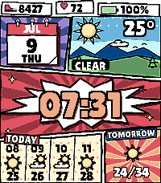

<!-- Generated by scripts/update_app_directory.py: do not edit by hand -->
[← All Pebble Developers](../developers.md)

# chocholom

*1 watchface · Last updated 2026-10-12 · [About these lists](../about-app-lists.md)*

Links: [Pebble App Store](https://apps.repebble.com/apps/dev/chocholom_6a4a52b1b297de00081b9f7b) · [GitHub (chocholom)](https://github.com/chocholom)

<h2 class="app-name" id="app-6a4a56c555030a000985bef5"><a href="https://apps.repebble.com/6a4a56c555030a000985bef5">Comic weather</a> v1.3.0</h2>
<a class="app-source" href="https://github.com/chocholom/pebble_commics_weather_watchface" title="Source code" data-search-exclude>View source</a>

Watchface · <a href="https://forum.rebble.io/t/1121" title="Discuss this app on the Rebble forum" data-search-exclude>Forum thread</a>

GPL-3.0 Released 2026-07-05 Updated 2026-07-11

Runs on: Time 2

A comic-book watchface inspired by the awesome Comic Drop but with the weather forecast I was missing there. - current temperature + condition with a hand-drawn scene (clear / cloudy / rain / snow…

