<!-- Generated by scripts/update_app_directory.py: do not edit by hand -->
[← All Pebble Developers](../developers.md)

# chops

*34 watchfaces · Last updated 2026-10-11 · [About these lists](../about-app-lists.md)*

Links: [Pebble App Store](https://apps.repebble.com/apps/dev/chops_52d76309bd61272345000001) · [Rebble App Store](https://apps.rebble.io/en_US/developer/52d76309bd61272345000001/1) · [GitHub (mereed)](https://github.com/mereed) · [Website (markreed8.wix.com)](http://markreed8.wix.com/chopspebblefaces)

<button type="button" data-filter="all" aria-pressed="true">All 34</button><button type="button" data-filter="watchface" aria-pressed="false">Watchfaces 34</button><button type="button" data-filter="watchapp" aria-pressed="false" disabled>Apps 0</button>

<label class="dev-sort">Sort by <select><option value="updated">Recently updated</option><option value="released">Newest release</option><option value="title">A–Z</option></select></label>

<a class="app-shot" href="https://apps.repebble.com/53fb3336155524e5e2000103" data-search-exclude>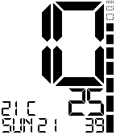</a>

<h2 class="app-name" id="app-53fb3336155524e5e2000103"><a href="https://apps.repebble.com/53fb3336155524e5e2000103">Big Digital 3</a> v1.7</h2>
<a class="app-source" href="https://github.com/mereed/pebbleface-bigdig3" title="Source code" data-search-exclude>View source</a>

Watchface

Released 2014-08-25 Updated 2025-12-01

Runs on: Time 2, Pebble 2 Duo, Pebble 2, Time, Classic

This is an enhanced version of a much earlier generated watchface. Have everything on, or have it all off (for a very minimal display) You can do the following via settings - turn on/off the…

<h2 class="app-name" id="app-59cf8379461a8da6ca0021f9"><a href="https://apps.rebble.io/en_US/application/59cf8379461a8da6ca0021f9">Pixely</a> v1.0</h2>
<a class="app-source" href="https://github.com/mereed/pebbleface-pixely" title="Source code" data-search-exclude>View source</a>

Watchface

Released 2017-09-30 Updated 2017-10-01 Rebble App Store

Runs on: Round 2, Time 2, Pebble 2 Duo, Pebble 2, Time Round, Time, Classic

This watchface is sort of a new version of the watchface &quot;PixelSeconds&quot; first published back in May 2014. It&#x27;s quite simple - just date and time, with BT status and battery level. On a PTR, the…

<h2 class="app-name" id="app-59c65f1d0dfc321335001f78"><a href="https://apps.rebble.io/en_US/application/59c65f1d0dfc321335001f78">Hieroglyph</a> v1.0</h2>
<a class="app-source" href="https://github.com/mereed/pebbleface-hieroglyph" title="Source code" data-search-exclude>View source</a>

Watchface

Released 2017-09-23 Updated 2017-09-23 Rebble App Store

Runs on: Round 2, Time Round

PTR watchface only - via a reddit request from RESPEKTOR Change hand colours Change style - hieroglyphs only, with main numbers (roman numerals), or star signs.

<h2 class="app-name" id="app-594cbf8ab67f9f9e8100137c"><a href="https://apps.rebble.io/en_US/application/594cbf8ab67f9f9e8100137c">Lime</a> v1.5</h2>
<a class="app-source" href="https://github.com/mereed/pebbleface-lime" title="Source code" data-search-exclude>View source</a>

Watchface

Released 2017-06-23 Updated 2017-09-17 Rebble App Store

Runs on: Time 2, Pebble 2 Duo, Pebble 2, Time, Classic

This simple watchface is based on some of the promotional images for the Charcoal/Lime Pebble2, with some extra stuff added, and it works on all rectangular watches. Down the left side (top down)…

<h2 class="app-name" id="app-566782ff39c4857dc4000033"><a href="https://apps.repebble.com/566782ff39c4857dc4000033">Themes</a> v2.0</h2>
<a class="app-source" href="https://github.com/mereed/pebbleface-themes" title="Source code" data-search-exclude>View source</a>

Watchface

Released 2015-12-09 Updated 2017-09-16

Runs on: Round 2, Time 2, Time Round, Time

jul 15: refreshed most images/themes battery only shows if below 40% slightly modified layout to see more of each image option to hide weather info ----- The layout here is very simple - just a…

<h2 class="app-name" id="app-53118426c6c18ea5af00011a"><a href="https://apps.repebble.com/53118426c6c18ea5af00011a">Taller</a> v5.0</h2>
<a class="app-source" href="https://github.com/mereed/pebbleface-taller-colour" title="Source code" data-search-exclude>View source</a>

Watchface

Released 2014-03-01 Updated 2017-07-02

Runs on: Round 2, Time 2, Pebble 2 Duo, Pebble 2, Time Round, Time, Classic

A very simple and readable watchface - show the day/date, flip it, or show a colon. Invert for a white background. Change the color of minute numbers or hour numbers. 12 and 24hr are supported…

<a class="app-shot" href="https://apps.repebble.com/533e13ed122201b48200016c" data-search-exclude>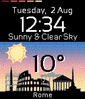</a>

<h2 class="app-name" id="app-533e13ed122201b48200016c"><a href="https://apps.repebble.com/533e13ed122201b48200016c">City Temp</a> v3.7</h2>
<a class="app-source" href="https://github.com/mereed/pebbleface-citytemp" title="Source code" data-search-exclude>View source</a>

Watchface

Released 2014-04-04 Updated 2017-06-12

Runs on: Round 2, Time 2, Pebble 2 Duo, Pebble 2, Time Round, Time, Classic

13 aug. added bogota, calgary, seattle Battery level is shown across the top in 10% increments, and when BT is lost the building windows and sky disappear and the watch vibrates. Supports 12/24hr…

<a class="app-shot" href="https://apps.rebble.io/en_US/application/58e491216ca3871e00000587" data-search-exclude>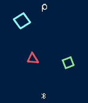</a>

<h2 class="app-name" id="app-58e491216ca3871e00000587"><a href="https://apps.rebble.io/en_US/application/58e491216ca3871e00000587">Shapes</a> v1.1</h2>
<a class="app-source" href="https://github.com/mereed/pebbleface-emojishapes" title="Source code" data-search-exclude>View source</a>

Watchface

Released 2017-04-05 Updated 2017-06-01 Rebble App Store

Runs on: Round 2, Time 2, Pebble 2 Duo, Pebble 2, Time Round, Time, Classic

It&#x27;s basically just a simple analog watch, with the hands represented by shapes. Hours are represented by the diamond (or smaller square), and minutes the larger square. If shown, seconds are…

<a class="app-shot" href="https://apps.rebble.io/en_US/application/58c4e18b0dfc32d35b000eea" data-search-exclude>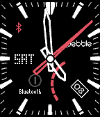</a>

<h2 class="app-name" id="app-58c4e18b0dfc32d35b000eea"><a href="https://apps.rebble.io/en_US/application/58c4e18b0dfc32d35b000eea">Edifice EQB-500</a> v1.8</h2>
<a class="app-source" href="https://github.com/mereed/pebbleface-edifice" title="Source code" data-search-exclude>View source</a>

Watchface

Released 2017-03-12 Updated 2017-05-06 Rebble App Store

Runs on: Round 2, Time 2, Time Round, Time

v1.5: added a RECT background option (ps. the grey rings will overlap tics a bit, but you can turn them off if you want) ------- A variation of the Casio Edifice EQB-500DC-1A The initial idea for…

<a class="app-shot" href="https://apps.rebble.io/en_US/application/58de41a00dfc3225f200091c" data-search-exclude>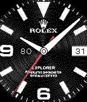</a>

<h2 class="app-name" id="app-58de41a00dfc3225f200091c"><a href="https://apps.rebble.io/en_US/application/58de41a00dfc3225f200091c">RolexMultiFace</a> v1.0</h2>
<a class="app-source" href="https://github.com/mereed/pebbleface-emojirolexmultiface" title="Source code" data-search-exclude>View source</a>

Watchface

Released 2017-03-31 Updated 2017-03-31 Rebble App Store

Runs on: Round 2, Time 2, Time Round, Time

Which Rolex today... Yet another Rolex clone. This watchface contains 6 styles (faces) to choose from. Original request by Martin Claptrap. Settings include, Turn date/on/off Turn battery number…

<h2 class="app-name" id="app-5422714343797646020000ff"><a href="https://apps.repebble.com/5422714343797646020000ff">Taller2</a> v3.1</h2>
<a class="app-source" href="http://www.github.com/mereed/pebbleface-taller2" title="Source code" data-search-exclude>View source</a>

Watchface

No licence Released 2014-09-24 Updated 2017-03-18

Runs on: Time 2, Pebble 2 Duo, Pebble 2, Time, Classic

22 sep: new clay settings, includes access to full pebble color palette big time, with day/date at 90 degrees. uncomplicated. change hour/minute colour. optional battery bar at the top. languages…

<h2 class="app-name" id="app-58a6eb346ca3875ead00048a"><a href="https://apps.rebble.io/en_US/application/58a6eb346ca3875ead00048a">Timeless Radial</a> v1.0</h2>
<a class="app-source" href="https://github.com/mereed/pebbleface-timelessradial" title="Source code" data-search-exclude>View source</a>

Watchface

Released 2017-02-17 Updated 2017-02-17 Rebble App Store

Runs on: Round 2, Time Round

A PTR only watchface. Again - a simple timeless design. Configuration options include, - second hand on/off - battery icon on/off - day and/or date on/off - set colours for the hour, minute and…

<a class="app-shot" href="https://apps.rebble.io/en_US/application/5899600d6d34e335f300025d" data-search-exclude>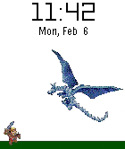</a>

<h2 class="app-name" id="app-5899600d6d34e335f300025d"><a href="https://apps.rebble.io/en_US/application/5899600d6d34e335f300025d">Dragon Attack</a> v1.0</h2>
<a class="app-source" href="https://github.com/mereed/pebbleface-dragonattack" title="Source code" data-search-exclude>View source</a>

Watchface

Released 2017-02-07 Updated 2017-02-07 Rebble App Store

Runs on: Round 2, Time 2, Time Round, Time

The dragon animates each minute - via settings select how many times it breathes fire - or disable the animation altogether. The small warrior, lower left, will disappear when BT is disconnected…

<a class="app-shot" href="https://apps.rebble.io/en_US/application/587352f85de8506635000363" data-search-exclude>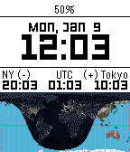</a>

<h2 class="app-name" id="app-587352f85de8506635000363"><a href="https://apps.rebble.io/en_US/application/587352f85de8506635000363">DayNight Timezones 2</a> v1.0</h2>
<a class="app-source" href="https://github.com/mereed/pebbleface-dntz" title="Source code" data-search-exclude>View source</a>

Watchface

Released 2017-01-09 Updated 2017-01-09 Rebble App Store

Runs on: Round 2, Time 2, Pebble 2 Duo, Pebble 2, Time Round, Time, Classic

Here the code to calculate day/night on the map was written by David Gianforte, then modified and shared by &#x27;Ben’, then by me. I&#x27;ve modified the design and layout, and added a few different styles…

<a class="app-shot" href="https://apps.repebble.com/53567bdf3a327510d600016e" data-search-exclude>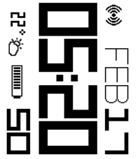</a>

<h2 class="app-name" id="app-53567bdf3a327510d600016e"><a href="https://apps.repebble.com/53567bdf3a327510d600016e">90degrees A</a> v1.9</h2>
<a class="app-source" href="https://github.com/mereed/pebbleface-90degA" title="Source code" data-search-exclude>View source</a>

Watchface

Released 2014-04-22 Updated 2017-01-02

Runs on: Time 2, Pebble 2 Duo, Pebble 2, Time, Classic

feb 17: supports aplite/basalt platforms, added wether temp number, fixed weather api issue everything is rotated 90 degrees for sideways reading. found it quite useful since i spend most of my…

<a class="app-shot" href="https://apps.rebble.io/en_US/application/57f2398405e4b17492000129" data-search-exclude>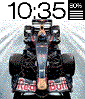</a>

<h2 class="app-name" id="app-57f2398405e4b17492000129"><a href="https://apps.rebble.io/en_US/application/57f2398405e4b17492000129">Wallpaper</a> v1.3</h2>
<a class="app-source" href="https://github.com/mereed/pebbleface-wallpaper" title="Source code" data-search-exclude>View source</a>

Watchface

Released 2016-10-03 Updated 2016-12-11 Rebble App Store

Runs on: Round 2, Time 2, Pebble 2 Duo, Pebble 2, Time Round, Time, Classic

I&#x27;ve been working on this one for a while, so have finished it off. After a number of design iterations, i&#x27;m done. It&#x27;s similar to another of my watchfaces (Themes), but, here there&#x27;s no weather…

<a class="app-shot" href="https://apps.repebble.com/53affa29a3fce736d4000151" data-search-exclude>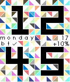</a>

<h2 class="app-name" id="app-53affa29a3fce736d4000151"><a href="https://apps.repebble.com/53affa29a3fce736d4000151">PrismClock</a> v4.0</h2>
<a class="app-source" href="https://github.com/mereed/pebbleface-prismclock" title="Source code" data-search-exclude>View source</a>

Watchface

Released 2014-06-29 Updated 2016-10-17

Runs on: Round 2, Time 2, Pebble 2 Duo, Pebble 2, Time Round, Time, Classic

update 17 oct: new settings page, new colours, other small graphic changes The watchface just shows time - with a colourful background for all pebble time watches. Extra Info (day/date/bt/batt)…

<a class="app-shot" href="https://apps.repebble.com/52f36a4dd690783a4400013c" data-search-exclude>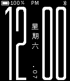</a>

<h2 class="app-name" id="app-52f36a4dd690783a4400013c"><a href="https://apps.repebble.com/52f36a4dd690783a4400013c">Big Black and Simple</a> v3.3</h2>
<a class="app-source" href="https://github.com/mereed/pebbleface-bigblack" title="Source code" data-search-exclude>View source</a>

Watchface

Released 2014-02-06 Updated 2016-10-05

Runs on: Time 2, Pebble 2 Duo, Pebble 2, Time, Classic

22 Sep: added new clay settings page This watchface is based on code for the original 91 dub but has been adapted a lot and was designed originally for a black pebble. All it does is display…

<a class="app-shot" href="https://apps.repebble.com/55aa599e27eb8dd245000090" data-search-exclude>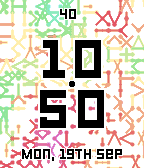</a>

<h2 class="app-name" id="app-55aa599e27eb8dd245000090"><a href="https://apps.repebble.com/55aa599e27eb8dd245000090">Perlin</a> v2.0</h2>
<a class="app-source" href="https://github.com/mereed/pebbleface-perlin" title="Source code" data-search-exclude>View source</a>

Watchface

Released 2015-07-18 Updated 2016-09-19

Runs on: Round 2, Time 2, Time Round, Time

19 Sept: update for sdk 4 quick view. Also replaced all images, and a new (clay) settings page. ----- This is a watchface developed to showcase the stunning digital artwork of Laurens Lapre - see…

<a class="app-shot" href="https://apps.repebble.com/57b078d7bb85eded8e00045c" data-search-exclude>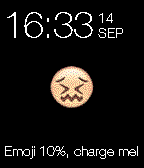</a>

<h2 class="app-name" id="app-57b078d7bb85eded8e00045c"><a href="https://apps.repebble.com/57b078d7bb85eded8e00045c">Emoji</a> v1.1</h2>
<a class="app-source" href="https://github.com/mereed/pebbleface-emoji" title="Source code" data-search-exclude>View source</a>

Watchface

Released 2016-08-14 Updated 2016-09-14

Runs on: Round 2, Time 2, Pebble 2 Duo, Pebble 2, Time Round, Time, Classic

This is a very simple watchface - the idea for this came from a picture I saw (unknown author) - and I thought I could easily turn it into a simple watchface. A new emoji face shows each time the…

<h2 class="app-name" id="app-565b94b54f2675185500000a"><a href="https://apps.repebble.com/565b94b54f2675185500000a">Natural Earth</a> v1.3</h2>
<a class="app-source" href="https://github.com/mereed/pebbleface-naturalearth" title="Source code" data-search-exclude>View source</a>

Watchface

Released 2015-11-30 Updated 2016-07-28

Runs on: Round 2, Time 2, Pebble 2 Duo, Pebble 2, Time Round, Time, Classic

The original idea for this simple watchface came from another project i&#x27;m working on - creating a world map (in three parts, each about 2m high x 1.5m wide). So this is obviously a much much…

<h2 class="app-name" id="app-579574dc50c752b5c90003b4"><a href="https://apps.repebble.com/579574dc50c752b5c90003b4">Ticker 2</a> v1.1</h2>
<a class="app-source" href="https://github.com/mereed/pebbleface-ticke2" title="Source code" data-search-exclude>View source</a>

Watchface

Released 2016-07-25 Updated 2016-07-27

Runs on: Round 2, Time 2, Time Round, Time

27 july option to disable pattern on analog screen removed inner black circle batt charging text same colour as scroll text This came about while working on an update for my original &quot;Ticker Time&quot;…

<h2 class="app-name" id="app-56dfbb1868994ff0fd00004b"><a href="https://apps.repebble.com/56dfbb1868994ff0fd00004b">Trek Pics</a> v1.5</h2>
<a class="app-source" href="https://github.com/mereed/pebbleface-trekpics" title="Source code" data-search-exclude>View source</a>

Watchface

Released 2016-03-09 Updated 2016-05-14

Runs on: Round 2, Time 2, Time Round, Time

Another watchface for the Trek fans. This is a bit simpler, though has a variety of images to display. View the time in large numbers, or set it to random (with one of the smaller date/time…

<a class="app-shot" href="https://apps.repebble.com/570b4e12235d5a6cbd000017" data-search-exclude>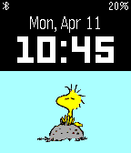</a>

<h2 class="app-name" id="app-570b4e12235d5a6cbd000017"><a href="https://apps.repebble.com/570b4e12235d5a6cbd000017">Woodstock</a> v1.0</h2>
<a class="app-source" href="http://github.com/mereed/pebbleface-woodstock" title="Source code" data-search-exclude>View source</a>

Watchface

No licence Released 2016-04-11 Updated 2016-04-11

Runs on: Round 2, Time 2, Time Round, Time

A very simple watchface - so no settings/flicks/vibes etc, created for a user request. Every minute woodstock gets up and goes for a fly across the screen (with some trippy colours), then sits and…

<a class="app-shot" href="https://apps.repebble.com/551e75518c1827a9c900000f" data-search-exclude>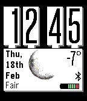</a>

<h2 class="app-name" id="app-551e75518c1827a9c900000f"><a href="https://apps.repebble.com/551e75518c1827a9c900000f">WidgetFace</a> v2.1</h2>
<a class="app-source" href="http://github.com/mereed/pebbleface-widgetface" title="Source code" data-search-exclude>View source</a>

Watchface

No licence Released 2015-04-03 Updated 2016-02-18

Runs on: Time 2, Pebble 2 Duo, Pebble 2, Time, Classic

The idea here originally came from the clock widgets on many phones. Here I&#x27;ve used the &#x27;SliderLayer&#x27; library by Yuriy Galanter (http://codecorner.galanter.net/2015/03/27/sliderlayer-for-pebble/)…

<a class="app-shot" href="https://apps.repebble.com/5608e554364a06ac41000024" data-search-exclude>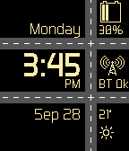</a>

<h2 class="app-name" id="app-5608e554364a06ac41000024"><a href="https://apps.repebble.com/5608e554364a06ac41000024">Cars</a> v2.1</h2>
<a class="app-source" href="https://github.com/mereed/pebbleface-cars" title="Source code" data-search-exclude>View source</a>

Watchface

Released 2015-09-28 Updated 2016-02-17

Runs on: Round 2, Time 2, Time Round, Time

Cars animate (travel across each road) every minute, and at start-up.

<a class="app-shot" href="https://apps.repebble.com/5359f131e03d48ecbf000101" data-search-exclude>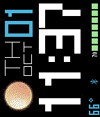</a>

<h2 class="app-name" id="app-5359f131e03d48ecbf000101"><a href="https://apps.repebble.com/5359f131e03d48ecbf000101">180degrees</a> v2.1</h2>
<a class="app-source" href="https://github.com/mereed/pebbleface-180degC" title="Source code" data-search-exclude>View source</a>

Watchface

Released 2014-04-25 Updated 2016-02-17

Runs on: Time 2, Pebble 2 Duo, Pebble 2, Time, Classic

&#x27;90degC&#x27; rotated for those who wear their watch on the right arm. ps. the previous version can be downloaded from my website.

<a class="app-shot" href="https://apps.repebble.com/55f8fa9dacde1781df000041" data-search-exclude>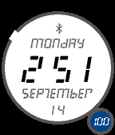</a>

<h2 class="app-name" id="app-55f8fa9dacde1781df000041"><a href="https://apps.repebble.com/55f8fa9dacde1781df000041">circLED</a> v1.0</h2>
<a class="app-source" href="https://github.com/mereed/pebbleface-circled" title="Source code" data-search-exclude>View source</a>

Watchface

Released 2015-09-16 Updated 2015-09-16

Runs on: Time 2, Pebble 2 Duo, Pebble 2, Time, Classic

A simple, but familiar design. Around the circle edge the minutes are indicated by a gap in the circle, while seconds can be displayed (for 30sec) via a shake of the watch. Seconds are not shown…

<a class="app-shot" href="https://apps.repebble.com/55b7a86cc156bdec1c00006e" data-search-exclude>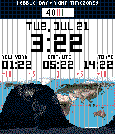</a>

<h2 class="app-name" id="app-55b7a86cc156bdec1c00006e"><a href="https://apps.repebble.com/55b7a86cc156bdec1c00006e">Day &amp; Night Timezones</a> v1.0</h2>
<a class="app-source" href="https://github.com/mereed/pebbleface-daynighttimezones" title="Source code" data-search-exclude>View source</a>

Watchface

Released 2015-07-28 Updated 2015-07-28

Runs on: Time 2, Pebble 2 Duo, Pebble 2, Time, Classic

Here the code was entirely written by David Gianforte, then modified and shared by &#x27;Ben&#x27;. I&#x27;ve just modified the design and layout. The idea is to demonstrate the benefit and advantage of an…

<a class="app-shot" href="https://apps.repebble.com/549bf479dc930364d8000251" data-search-exclude>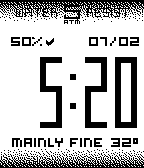</a>

<h2 class="app-name" id="app-549bf479dc930364d8000251"><a href="https://apps.repebble.com/549bf479dc930364d8000251">MyStyle</a> v2.1</h2>
<a class="app-source" href="https://github.com/mereed/pebbleface-mystyle" title="Source code" data-search-exclude>View source</a>

Watchface

Released 2014-12-25 Updated 2015-07-09

Runs on: Time 2, Pebble 2 Duo, Pebble 2, Time, Classic

26 mar: ability to turn off weather desc. Many thanks to those who helped with testing! ---------------------- Set your own style. A very simple watchface design with bigger numbers, a…

<a class="app-shot" href="https://apps.repebble.com/53bbdd253985a83bb80001ae" data-search-exclude>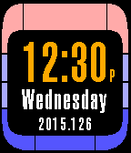</a>

<h2 class="app-name" id="app-53bbdd253985a83bb80001ae"><a href="https://apps.repebble.com/53bbdd253985a83bb80001ae">Sliding LCARS Time</a> v2.1</h2>
<a class="app-source" href="https://github.com/mereed/pebbleface-pebbleLCARStime" title="Source code" data-search-exclude>View source</a>

Watchface

Released 2014-07-08 Updated 2015-05-07

Runs on: Time 2, Pebble 2 Duo, Pebble 2, Time, Classic

Animates when you tap/shake. Supports 12/24hr. Battery level &amp; date displayed/revealed as part of the background when it animates. When no BT the bars above time and below &#x27;stardate&#x27; (year.daynum)…

<h2 class="app-name" id="app-53ca28c080f132f5b1000142"><a href="https://apps.repebble.com/53ca28c080f132f5b1000142">Contrast</a> v1.1</h2>
<a class="app-source" href="https://github.com/mereed/pebbleface-contrast" title="Source code" data-search-exclude>View source</a>

Watchface

Released 2014-07-19 Updated 2015-02-13

Runs on: Time 2, Pebble 2 Duo, Pebble 2, Time, Classic

simple digital time. customise your style. select from: - all black (with white text) or white vertical stripe (and black text) behind mins - timeformat on/off - bluetooth vibe on/off - hourly…

<a class="app-shot" href="https://apps.repebble.com/545d7e8cf17b0f08ca000001" data-search-exclude>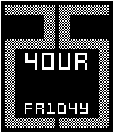</a>

<h2 class="app-name" id="app-545d7e8cf17b0f08ca000001"><a href="https://apps.repebble.com/545d7e8cf17b0f08ca000001">Mixup</a> v1.2</h2>
<a class="app-source" href="https://github.com/mereed/pebbleface-mixup" title="Source code" data-search-exclude>View source</a>

Watchface

Released 2014-11-08 Updated 2014-11-19

Runs on: Time 2, Pebble 2 Duo, Pebble 2, Time, Classic

[now includes ability to display normal or mixed text. also has invert, bluetooth vibe on/off, hourly vibe on/off - via settings page] Has text hours (with he hour number incorporated in mixed…

<h2 class="app-name" id="app-53e9cbba80a0272d690001cb"><a href="https://apps.repebble.com/53e9cbba80a0272d690001cb">Angled Left</a> v1.0</h2>
<a class="app-source" href="https://github.com/mereed/pebbleface-angled" title="Source code" data-search-exclude>View source</a>

Watchface

Released 2014-08-12 Updated 2014-08-19

Runs on: Time 2, Pebble 2 Duo, Pebble 2, Time, Classic

Borrows from a similar watchface, &#x27;diagonal&#x27;, by dotar, and similar to the &#x27;slanted&#x27; concept by firelighter. ps. the un-eveness of text is intentional. settings: invert, bluetooth vibe (with…

