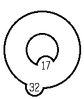

<!-- Generated by scripts/update_app_directory.py: do not edit by hand -->
[← All Pebble Developers](../developers.md)

# chrip

*1 watchface · Last updated 2026-10-12 · [About these lists](../about-app-lists.md)*

Links: [Pebble App Store](https://apps.repebble.com/apps/dev/chrip_569eb89fa1ebd0d5a9000005) · [GitHub (chrip)](https://github.com/chrip) · [Website (eyevido.de)](https://eyevido.de)

<h2 class="app-name" id="app-56d32235eb3b97f4da000028"><a href="https://apps.repebble.com/56d32235eb3b97f4da000028">Inner Circle</a> v0.2</h2>
<a class="app-source" href="https://github.com/chrip/pebble_wachtfaces" title="Source code" data-search-exclude>View source</a>

Watchface

No licence Released 2016-02-28 Updated 2016-03-25

Runs on: Round 2, Time 2, Pebble 2 Duo, Pebble 2, Time Round, Time, Classic

Just the time in circles.

