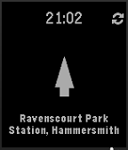

<!-- Generated by scripts/update_app_directory.py: do not edit by hand -->
[← All Pebble Developers](../developers.md)

# Chris Berry

*1 app · Last updated 2026-10-11 · [About these lists](../about-app-lists.md)*

Links: [Pebble App Store](https://apps.repebble.com/apps/dev/chris-berry_55c8ff87d0e6da5f0a00002e) · [GitHub (chrisberry4545)](https://github.com/chrisberry4545) · [Website (chrisberry4545.github.io)](http://chrisberry4545.github.io/)

<h2 class="app-name" id="app-55c90209d0e6da92ae000036"><a href="https://apps.repebble.com/55c90209d0e6da92ae000036">London TFL Bike Point Tracker</a> v1.1</h2>
<a class="app-source" href="https://github.com/chrisberry4545/BikeTracker" title="Source code" data-search-exclude>View source</a>

App

Released 2015-08-10 Updated 2015-09-21

Runs on: Time 2, Time

Points the way to the nearest Satander bike point in London. Useful for when you&#x27;re cycling around London.

