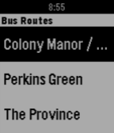

<!-- Generated by scripts/update_app_directory.py: do not edit by hand -->
[← All Pebble Developers](../developers.md)

# Chris Bitler

*1 app · Last updated 2026-10-12 · [About these lists](../about-app-lists.md)*

Links: [Pebble App Store](https://apps.repebble.com/apps/dev/chris-bitler_56db268aeeaab1a2af000030) · [GitHub (Chris-Bitler)](https://github.com/Chris-Bitler)

<h2 class="app-name" id="app-56e8053abbcd74ba4b000004"><a href="https://apps.repebble.com/56e8053abbcd74ba4b000004">RITBus [BETA]</a> v1.2</h2>
<a class="app-source" href="https://github.com/Chris-Bitler/RITBus" title="Source code" data-search-exclude>View source</a>

App

GPL-3.0 Released 2016-03-15 Updated 2016-03-17

Runs on: Time 2, Pebble 2 Duo, Pebble 2, Time, Classic

An app that allows Rochester Institute of Technology students to see how soon the various campus busses are going to hit the bus stops. A few of these busses currently don&#x27;t work due to an issue…

