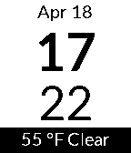

<!-- Generated by scripts/update_app_directory.py: do not edit by hand -->
[← All Pebble Developers](../developers.md)

# Chris C.

*3 watchfaces · Last updated 2026-10-12 · [About these lists](../about-app-lists.md)*

Links: [Pebble App Store](https://apps.repebble.com/apps/dev/chris-c_531a25942559af741f00029f) · [GitHub (cartyc)](https://github.com/cartyc)

<button type="button" data-filter="all" aria-pressed="true">All 3</button><button type="button" data-filter="watchface" aria-pressed="false">Watchfaces 3</button><button type="button" data-filter="watchapp" aria-pressed="false" disabled>Apps 0</button>

<label class="dev-sort">Sort by <select><option value="updated">Recently updated</option><option value="released">Newest release</option><option value="title">A–Z</option></select></label>

<h2 class="app-name" id="app-5527c66678b67bc4a7000012"><a href="https://apps.repebble.com/5527c66678b67bc4a7000012">simpleTime_Farenheight</a> v1.0</h2>
<a class="app-source" href="https://github.com/cartyc/simpleTimeVertical/tree/farenheight" title="Source code" data-search-exclude>View source</a>

Watchface

GPL-2.0 Released 2015-04-10 Updated 2015-04-18

Runs on: Time 2, Pebble 2 Duo, Pebble 2, Time, Classic

Just a simple watchface that displays, the date/time/weather(in Farenheight). Uses your phones location service to provide weather data. Weather updates every 15 minutes.

<h2 class="app-name" id="app-5527c60ae0d843430d00001b"><a href="https://apps.repebble.com/5527c60ae0d843430d00001b">simpleTime_Kelvin</a> v1.0</h2>
<a class="app-source" href="https://github.com/cartyc/simpleTimeVertical/tree/kelvins" title="Source code" data-search-exclude>View source</a>

Watchface

GPL-2.0 Released 2015-04-10 Updated 2015-04-12

Runs on: Time 2, Pebble 2 Duo, Pebble 2, Time, Classic

Just a simple watchface that displays, the date/time/weather(in kelvins!). Uses your phones location service to provide weather data. Weather updates every 15 minutes.

<h2 class="app-name" id="app-55120579c496d87e9e000060"><a href="https://apps.repebble.com/55120579c496d87e9e000060">SimpleTime</a> v1.1</h2>
<a class="app-source" href="https://github.com/cartyc/simpleTimeVertical" title="Source code" data-search-exclude>View source</a>

Watchface

GPL-2.0 Released 2015-03-25 Updated 2015-04-12

Runs on: Time 2, Pebble 2 Duo, Pebble 2, Time, Classic

Just a simple watchface that displays, the date/time/weather(in Celcius!). Uses your phones location service to provide weather data. Weather updates every 15 minutes.

