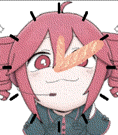
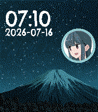

<!-- Generated by scripts/update_app_directory.py: do not edit by hand -->
[← All Pebble Developers](../developers.md)

# Chris Eilander.nl

*2 watchfaces · Last updated 2026-10-12 · [About these lists](../about-app-lists.md)*

Links: [Pebble App Store](https://apps.repebble.com/apps/dev/chris-eilander-nl_546da3e6e2a84b10b200006a) · [GitHub (chriseilander)](https://github.com/chriseilander) · [Website (chriseilander.nl)](https://chriseilander.nl)

<button type="button" data-filter="all" aria-pressed="true">All 2</button><button type="button" data-filter="watchface" aria-pressed="false">Watchfaces 2</button><button type="button" data-filter="watchapp" aria-pressed="false" disabled>Apps 0</button>

<label class="dev-sort">Sort by <select><option value="updated">Recently updated</option><option value="released">Newest release</option><option value="title">A–Z</option></select></label>

<h2 class="app-name" id="app-ed9c321605604b67b54d621a"><a href="https://apps.repebble.com/ed9c321605604b67b54d621a">Kasane Teto Analog Baguette</a> v1.0.0</h2>
<a class="app-source" href="https://github.com/chriseilander/TetoAnalogBaguette" title="Source code" data-search-exclude>View source</a>

Watchface · <a href="https://forum.rebble.io/t/1221" title="Discuss this app on the Rebble forum" data-search-exclude>Forum thread</a>

No licence Released 2026-08-09 Updated 2026-08-09

Runs on: Round 2, Time 2, Time Round, Time

A Kasane Teto watchface featuring her favorite food as minute and hour hands. Perfect for round screens. This watchface might be a bit heavy on the RAM side.

<h2 class="app-name" id="app-91a9cfaa6c714c3c8983b57b"><a href="https://apps.repebble.com/91a9cfaa6c714c3c8983b57b">Yuru Camp Mount Fuji</a> v1.1.1</h2>
<a class="app-source" href="https://github.com/chriseilander/YuruCampFujiWatchFace" title="Source code" data-search-exclude>View source</a>

Watchface · <a href="https://forum.rebble.io/t/1178" title="Discuss this app on the Rebble forum" data-search-exclude>Forum thread</a>

No licence Released 2026-07-16 Updated 2026-07-23

Runs on: Round 2, Time 2, Pebble 2 Duo, Pebble 2, Time Round, Time, Classic

Laid-Back Camping with the Yuru Camp Mount Fuji watchface. A watchface with a beautiful night sky view of mount Fuji straight from the Anime. Accompanied with the face of your favorite camper…

