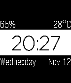
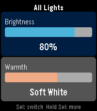
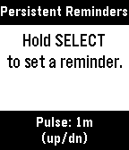

<!-- Generated by scripts/update_app_directory.py: do not edit by hand -->
[← All Pebble Developers](../developers.md)

# Chris Lewicki

*2 watchfaces and 2 apps · Last updated 2026-10-11 · [About these lists](../about-app-lists.md)*

Links: [Pebble App Store](https://apps.repebble.com/apps/dev/chris-lewicki_53f25ba1e45d533568000139) · [GitHub (chrislewicki)](https://github.com/chrislewicki) · [Website (lewicki.dev)](https://lewicki.dev)

<button type="button" data-filter="all" aria-pressed="true">All 4</button><button type="button" data-filter="watchface" aria-pressed="false">Watchfaces 2</button><button type="button" data-filter="watchapp" aria-pressed="false">Apps 2</button>

<label class="dev-sort">Sort by <select><option value="updated">Recently updated</option><option value="released">Newest release</option><option value="title">A–Z</option></select></label>

<h2 class="app-name" id="app-69153581a0d99d0009ff0a03"><a href="https://apps.repebble.com/69153581a0d99d0009ff0a03">A Little More</a> v3.2.0</h2>
<a class="app-source" href="https://github.com/chrislewicki/A-Little-More" title="Source code" data-search-exclude>View source</a>

Watchface

Released 2025-11-13 Updated 2026-09-21

Runs on: Round 2, Time 2, Pebble 2 Duo, Pebble 2, Time Round, Time, Classic

A full remake of my face A Little Less, with more features and much cleaner code. Complications in each corner can be customized to be any of the following: - Battery - Temperature - Day of week …

<h2 class="app-name" id="app-4a2a52d2490b4e9a8fd66073"><a href="https://apps.repebble.com/4a2a52d2490b4e9a8fd66073">F-84W</a> v1.2</h2>
<a class="app-source" href="https://github.com/chrislewicki/F-84W" title="Source code" data-search-exclude>View source</a>

Watchface

Released 2026-06-07 Updated 2026-06-07

Runs on: Time 2

A (mostly) faithful recreation of the Casio F-84W, the Japan-exclusive, and much better looking, older brother of the classic F-91W. Just like the real watch, it can chime at the top of every…

<h2 class="app-name" id="app-71e51f9f204444e39374282a"><a href="https://apps.repebble.com/71e51f9f204444e39374282a">LIFX Client</a> v1.1</h2>
<a class="app-source" href="https://github.com/chrislewicki/lifx-client" title="Source code" data-search-exclude>View source</a>

App

Released 2026-04-04 Updated 2026-04-06

Runs on: Round 2, Time 2, Pebble 2 Duo, Pebble 2, Time Round, Time, Classic

Control your LIFX smart lights from your Pebble. LIFX Client lets you adjust brightness and color temperature on the fly, or pick from a palette of colors. Features: - Adjust brightness in 5%…

<h2 class="app-name" id="app-699b8db5c8946800093f0603"><a href="https://apps.repebble.com/699b8db5c8946800093f0603">Persistent Reminders</a> v1.1</h2>
<a class="app-source" href="https://github.com/chrislewicki/persistent-reminders" title="Source code" data-search-exclude>View source</a>

App

Released 2026-02-22 Updated 2026-04-04

Runs on: Round 2, Time 2, Pebble 2 Duo, Pebble 2, Time Round, Time

A reminders app for people who need reminders for their reminders. Dictate the thing you need to be reminded of and when (i.e. &quot;Do the dishes in 1 hour 30 minutes&quot;), and Persistent Reminders will…

