<!-- Generated by scripts/update_app_directory.py: do not edit by hand -->
[← All Pebble Developers](../developers.md)

# Chris Lewis

*30 watchfaces and 6 apps · Last updated 2026-10-12 · [About these lists](../about-app-lists.md)*

Links: [Pebble App Store](https://apps.repebble.com/apps/dev/chris-lewis_5299cd30e627ce1147000099) · [GitHub (C-D-Lewis)](https://github.com/C-D-Lewis) · [Website (ninedof.wordpress.com)](http://ninedof.wordpress.com)

<button type="button" data-filter="all" aria-pressed="true">All 36</button><button type="button" data-filter="watchface" aria-pressed="false">Watchfaces 30</button><button type="button" data-filter="watchapp" aria-pressed="false">Apps 6</button>

<label class="dev-sort">Sort by <select><option value="updated">Recently updated</option><option value="released">Newest release</option><option value="title">A–Z</option></select></label>

<a class="app-shot" href="https://apps.repebble.com/077577b50210479da1285f84" data-search-exclude>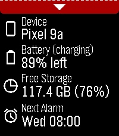</a>

<h2 class="app-name" id="app-077577b50210479da1285f84"><a href="https://apps.repebble.com/077577b50210479da1285f84">Dashboard 2</a> v1.0.0</h2>
<a class="app-source" href="https://github.com/C-D-Lewis/pebble-dev/tree/master/watchapps/dashboard2" title="Source code" data-search-exclude>View source</a>

App · <a href="https://forum.rebble.io/t/1304" title="Discuss this app on the Rebble forum" data-search-exclude>Forum thread</a>

No licence Released 2026-08-31 Updated 2026-08-31

Runs on: Round 2, Time 2, Pebble 2 Duo, Pebble 2, Time Round, Time, Classic

**IMPORTANT**: Requires Android companion app which is available from GitHub (https://github.com/C-D-Lewis/pebble-dev/tree/master/watchapps/dashboard2) or compiled from source with Android Studio…

<h2 class="app-name" id="app-550ccb556caaed4e0100006d"><a href="https://apps.repebble.com/550ccb556caaed4e0100006d">Thin</a> v1.20.0</h2>
<a class="app-source" href="https://github.com/C-D-Lewis/pebble-dev" title="Source code" data-search-exclude>View source</a>

Watchface · <a href="https://forum.rebble.io/t/319" title="Discuss this app on the Rebble forum" data-search-exclude>Forum thread</a>

No licence Released 2015-03-21 Updated 2026-08-16

Runs on: Round 2, Time 2, Pebble 2 Duo, Pebble 2, Time Round, Time, Classic

Simple, customizable watchface with splashes of color. Shows battery level with hour markers. Use the config page to adjust which features you want from: - Show weekday/month - Show day of the…

<a class="app-shot" href="https://apps.repebble.com/569c52fcee59668e2f00001d" data-search-exclude>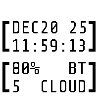</a>

<h2 class="app-name" id="app-569c52fcee59668e2f00001d"><a href="https://apps.repebble.com/569c52fcee59668e2f00001d">Brackets</a> v2.9.0</h2>
<a class="app-source" href="https://github.com/C-D-Lewis/pebble-dev" title="Source code" data-search-exclude>View source</a>

Watchface · <a href="https://forum.rebble.io/t/320" title="Discuss this app on the Rebble forum" data-search-exclude>Forum thread</a>

No licence Released 2016-01-18 Updated 2026-08-05

Runs on: Round 2, Time 2, Pebble 2 Duo, Pebble 2, Time Round, Time, Classic

High contrast watchface between brackets. Shows battery, Bluetooth, and weather if enabled.

<a class="app-shot" href="https://apps.repebble.com/67def87c122b40000904b4f0" data-search-exclude>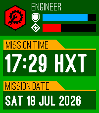</a>

<h2 class="app-name" id="app-67def87c122b40000904b4f0"><a href="https://apps.repebble.com/67def87c122b40000904b4f0">Deep Rock</a> v1.3.0</h2>
<a class="app-source" href="https://github.com/C-D-Lewis/pebble-dev" title="Source code" data-search-exclude>View source</a>

Watchface · <a href="https://forum.rebble.io/t/1165" title="Discuss this app on the Rebble forum" data-search-exclude>Forum thread</a>

No licence Released 2025-03-22 Updated 2026-07-18

Runs on: Time 2, Pebble 2 Duo, Pebble 2, Time, Classic

Listen up, miners! Management has seen fit to outfit you with the latest device from R&amp;D - a wrist-mounted display. Apparently the standard mission timer wasn&#x27;t enough to keep you on time and on…

<h2 class="app-name" id="app-692b3821d7dcba000a809ba5"><a href="https://apps.repebble.com/692b3821d7dcba000a809ba5">Muninn - Battery Wisdom</a> v1.50.0</h2>
<a class="app-source" href="https://github.com/C-D-Lewis/pebble-dev" title="Source code" data-search-exclude>View source</a>

App · <a href="https://forum.rebble.io/t/83" title="Discuss this app on the Rebble forum" data-search-exclude>Forum thread</a>

No licence Released 2025-11-29 Updated 2026-07-16

Runs on: Round 2, Time 2, Pebble 2 Duo, Pebble 2, Time Round, Time, Classic

Muninn is an extremely lightweight battery tracking and prediction app. It uses the Wakeup API (every 6 hours) instead of the Background Worker to monitor trends and provide insight without…

<h2 class="app-name" id="app-4b5cfd6f43024c438591c2c7"><a href="https://apps.repebble.com/4b5cfd6f43024c438591c2c7">patchwork</a> v1.3.0</h2>
<a class="app-source" href="https://github.com/C-D-Lewis/pebble-dev/tree/master/watchfaces/patchwork" title="Source code" data-search-exclude>View source</a>

Watchface · <a href="https://forum.rebble.io/t/828" title="Discuss this app on the Rebble forum" data-search-exclude>Forum thread</a>

No licence Released 2026-04-04 Updated 2026-06-23

Runs on: Round 2, Time 2, Time Round, Time

Patchwork uses isometric rendering to show randomized blocks at various heights and colors in your chosen color palette, overlaid with the time and date in a clean edged font. Choose your color…

<a class="app-shot" href="https://apps.repebble.com/68a492f024908f00096bb0b2" data-search-exclude>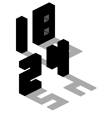</a>

<h2 class="app-name" id="app-68a492f024908f00096bb0b2"><a href="https://apps.repebble.com/68a492f024908f00096bb0b2">Void Statues</a> v1.8.0</h2>
<a class="app-source" href="https://github.com/C-D-Lewis/pebble-dev" title="Source code" data-search-exclude>View source</a>

Watchface · <a href="https://forum.rebble.io/t/624" title="Discuss this app on the Rebble forum" data-search-exclude>Forum thread</a>

No licence Released 2025-08-19 Updated 2026-06-14

Runs on: Round 2, Time 2, Pebble 2 Duo, Pebble 2, Time Round, Time, Classic

Isometric watchface that draws solid statues and casts grey or dithered shadows to show the time. Animates the current time on launch, and inverts colors during the night time. Shows wireframe…

<a class="app-shot" href="https://apps.repebble.com/529e8742d7894b189c000012" data-search-exclude>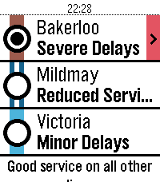</a>

<h2 class="app-name" id="app-529e8742d7894b189c000012"><a href="https://apps.repebble.com/529e8742d7894b189c000012">Tube Status</a> v3.14.0</h2>
<a class="app-source" href="https://github.com/C-D-Lewis/pebble-dev" title="Source code" data-search-exclude>View source</a>

App · <a href="https://forum.rebble.io/t/277" title="Discuss this app on the Rebble forum" data-search-exclude>Forum thread</a>

No licence Released 2013-12-04 Updated 2026-05-31

Runs on: Round 2, Time 2, Pebble 2 Duo, Pebble 2, Time Round, Time, Classic

See the line status of the London Underground from your wrist! Unofficial app using the TfL Unified API.

<a class="app-shot" href="https://apps.repebble.com/cac3689b5691473da9e3410b" data-search-exclude>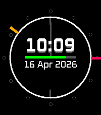</a>

<h2 class="app-name" id="app-cac3689b5691473da9e3410b"><a href="https://apps.repebble.com/cac3689b5691473da9e3410b">Skyarc</a> v1.10.0</h2>
<a class="app-source" href="https://github.com/C-D-Lewis/pebble-dev" title="Source code" data-search-exclude>View source</a>

Watchface · <a href="https://forum.rebble.io/t/858" title="Discuss this app on the Rebble forum" data-search-exclude>Forum thread</a>

No licence Released 2026-04-12 Updated 2026-05-08

Runs on: Round 2, Time 2, Pebble 2 Duo, Pebble 2, Time Round, Time, Classic

Daily weather-focused watchface with a comparatively minimal design. General weather conditions for the whole day (24H) are shown around the outside of the main arc, and relative temperatures…

<h2 class="app-name" id="app-67c5f245b7a02300092ba0b2"><a href="https://apps.repebble.com/67c5f245b7a02300092ba0b2">Hollywatch</a> v1.1.0</h2>
<a class="app-source" href="https://github.com/C-D-Lewis/pebble-dev" title="Source code" data-search-exclude>View source</a>

Watchface · <a href="https://forum.rebble.io/t/940" title="Discuss this app on the Rebble forum" data-search-exclude>Forum thread</a>

No licence Released 2025-03-03 Updated 2026-05-02

Runs on: Round 2, Time 2, Pebble 2 Duo, Pebble 2, Time Round, Time, Classic

Alright dudes? Timeless Holly in wrist-watch format is realised using 21st Century technology - way ahead of the futuristic original! Port of the Fitbit watchface of the same name.

<h2 class="app-name" id="app-6814ecea39c746298a549282"><a href="https://apps.repebble.com/6814ecea39c746298a549282">dont-panic</a> v1.1</h2>
<a class="app-source" href="https://github.com/C-D-Lewis/pebble-dev" title="Source code" data-search-exclude>View source</a>

Watchface · <a href="https://forum.rebble.io/t/900" title="Discuss this app on the Rebble forum" data-search-exclude>Forum thread</a>

No licence Released 2026-04-19 Updated 2026-04-22

Runs on: Round 2, Time 2, Time Round, Time

If you don&#x27;t always know were your towel is, at least you can have this gentle reminder that in hitchhiking, the number one rule is DON&#x27;T PANIC. And also know the time as well. After all, it might…

<h2 class="app-name" id="app-554574943bbdc6c8560000bf"><a href="https://apps.repebble.com/554574943bbdc6c8560000bf">Isotime</a> v1.17</h2>
<a class="app-source" href="https://github.com/C-D-Lewis/pebble-dev" title="Source code" data-search-exclude>View source</a>

Watchface · <a href="https://forum.rebble.io/t/623" title="Discuss this app on the Rebble forum" data-search-exclude>Forum thread</a>

No licence Released 2015-05-03 Updated 2026-04-17

Runs on: Round 2, Time 2, Pebble 2 Duo, Pebble 2, Time Round, Time, Classic

Large, sharp time shown using individual animated blocks drawn isometrically. Pick theme colours. Every time the minute changes, animates only the blocks that need changing. Digits go grey when BT…

<h2 class="app-name" id="app-56170d386ddd7f6aa0000025"><a href="https://apps.repebble.com/56170d386ddd7f6aa0000025">Time Dots</a> v1.6</h2>
<a class="app-source" href="https://github.com/C-D-Lewis/time-dots-appstore" title="Source code" data-search-exclude>View source</a>

Watchface · <a href="https://forum.rebble.io/t/399" title="Discuss this app on the Rebble forum" data-search-exclude>Forum thread</a>

No licence Released 2015-10-09 Updated 2026-04-05

Runs on: Round 2, Time 2, Pebble 2 Duo, Pebble 2, Time Round, Time, Classic

Watchface for Pebble showing the hours and minutes as a radial bar and dots.

<h2 class="app-name" id="app-67c47f3ad2acb30009a3c7d4"><a href="https://apps.repebble.com/67c47f3ad2acb30009a3c7d4">Pseudotime</a> v1.3</h2>
<a class="app-source" href="https://github.com/C-D-Lewis/pebble-dev" title="Source code" data-search-exclude>View source</a>

Watchface · <a href="https://forum.rebble.io/t/347" title="Discuss this app on the Rebble forum" data-search-exclude>Forum thread</a>

No licence Released 2025-03-02 Updated 2026-04-05

Runs on: Round 2, Time 2, Pebble 2 Duo, Pebble 2, Time Round, Time, Classic

Port of the Fitbit watchface of the same name. A simple watchface that shows the time with expanding colored bars, one for hours, minutes, and seconds, throughout the day. For when you don&#x27;t quite…

<h2 class="app-name" id="app-5387b383f60819963900000e"><a href="https://apps.repebble.com/5387b383f60819963900000e">News Headlines</a> v4.12</h2>
<a class="app-source" href="https://github.com/C-D-Lewis/pebble-dev" title="Source code" data-search-exclude>View source</a>

App · <a href="https://forum.rebble.io/t/290" title="Discuss this app on the Rebble forum" data-search-exclude>Forum thread</a>

No licence Released 2014-05-29 Updated 2026-01-28

Runs on: Round 2, Time 2, Pebble 2 Duo, Pebble 2, Time Round, Time, Classic

Read the top 10 - 20 BBC News stories on your wrist. Categories available: Headlines, World, UK, Politics, Science &amp; Environment, Technology, Health, Education, Entertainment &amp; Arts. Also includes…

<h2 class="app-name" id="app-52f10cf7a0cb6abe6d002f98"><a href="https://apps.repebble.com/52f10cf7a0cb6abe6d002f98">Split Horizon</a> v1.2</h2>
<a class="app-source" href="https://github.com/C-D-Lewis/pebble-dev" title="Source code" data-search-exclude>View source</a>

Watchface · <a href="https://forum.rebble.io/t/495" title="Discuss this app on the Rebble forum" data-search-exclude>Forum thread</a>

No licence Released 2014-02-04 Updated 2026-01-14

Runs on: Time 2, Pebble 2 Duo, Pebble 2, Time, Classic

The Split Horizon watch face. Configuration: - Animate markers at 15 second intervals, and the whole face each minute. - Show/hide the date.

<a class="app-shot" href="https://apps.repebble.com/5299d4da129af7d723000079" data-search-exclude>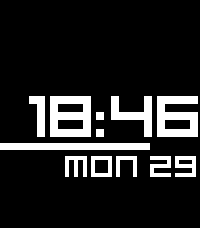</a>

<h2 class="app-name" id="app-5299d4da129af7d723000079"><a href="https://apps.repebble.com/5299d4da129af7d723000079">Beam Up</a> v3.9</h2>
<a class="app-source" href="https://github.com/C-D-Lewis/pebble-dev" title="Source code" data-search-exclude>View source</a>

Watchface · <a href="https://forum.rebble.io/t/387" title="Discuss this app on the Rebble forum" data-search-exclude>Forum thread</a>

No licence Released 2013-11-30 Updated 2026-01-14

Runs on: Round 2, Time 2, Pebble 2 Duo, Pebble 2, Time Round, Time, Classic

Note: All variant features are now rolled into this version! Choose from &#x27;Settings&#x27;. A minimal watch face with small, compact animations that show 15, 30 and 45 seconds past the minute. On the…

<a class="app-shot" href="https://apps.repebble.com/67c86c9db7a02300092ba0d4" data-search-exclude>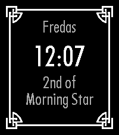</a>

<h2 class="app-name" id="app-67c86c9db7a02300092ba0d4"><a href="https://apps.repebble.com/67c86c9db7a02300092ba0d4">Morndas</a> v1.1</h2>
<a class="app-source" href="https://github.com/C-D-Lewis/pebble-dev" title="Source code" data-search-exclude>View source</a>

Watchface · <a href="https://forum.rebble.io/t/418" title="Discuss this app on the Rebble forum" data-search-exclude>Forum thread</a>

No licence Released 2025-03-05 Updated 2026-01-02

Runs on: Time 2, Pebble 2 Duo, Pebble 2, Time, Classic

Inspired by Skyrim, with a focus on readability

<a class="app-shot" href="https://apps.repebble.com/67c32b1fb7a02300092ba059" data-search-exclude>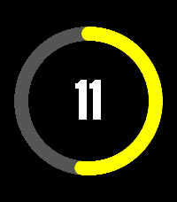</a>

<h2 class="app-name" id="app-67c32b1fb7a02300092ba059"><a href="https://apps.repebble.com/67c32b1fb7a02300092ba059">Dayring</a> v1.3</h2>
<a class="app-source" href="https://github.com/C-D-Lewis/pebble-dev" title="Source code" data-search-exclude>View source</a>

Watchface · <a href="https://forum.rebble.io/t/350" title="Discuss this app on the Rebble forum" data-search-exclude>Forum thread</a>

No licence Released 2025-03-01 Updated 2025-12-28

Runs on: Round 2, Time 2, Pebble 2 Duo, Pebble 2, Time Round, Time, Classic

Port of the Fitbit watchface of the same name, showing a colorful ring of minutes through the hour in two colors, one for day and another for night. The progress is animated upon launch.

<h2 class="app-name" id="app-533b2b90f9fe92524e00006a"><a href="https://apps.repebble.com/533b2b90f9fe92524e00006a">Potential Divider</a> v1.1</h2>
<a class="app-source" href="https://github.com/C-D-Lewis/pebble-dev" title="Source code" data-search-exclude>View source</a>

Watchface

No licence Released 2014-04-01 Updated 2025-08-25

Runs on: Time 2, Pebble 2 Duo, Pebble 2, Time, Classic

Shows a potential divider circuit with hours, minutes as R1 and R2, day of the month as input voltage, and real simulated output voltage. An animated &#x27;electron&#x27; moves around to show seconds.

<a class="app-shot" href="https://apps.repebble.com/689f0ed1ad152a00098e1b77" data-search-exclude>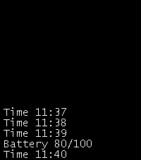</a>

<h2 class="app-name" id="app-689f0ed1ad152a00098e1b77"><a href="https://apps.repebble.com/689f0ed1ad152a00098e1b77">Events</a> v1.1</h2>
<a class="app-source" href="https://github.com/C-D-Lewis/pebble-dev" title="Source code" data-search-exclude>View source</a>

Watchface

No licence Released 2025-08-15 Updated 2025-08-15

Runs on: Time 2, Pebble 2 Duo, Pebble 2, Time, Classic

Simple watchface showing a scrolling list of SDK events

<h2 class="app-name" id="app-52e919c2ad615bf1a5000024"><a href="https://apps.repebble.com/52e919c2ad615bf1a5000024">CMD Time Typed</a> v1.1</h2>
<a class="app-source" href="https://github.com/C-D-Lewis/cmd-time-typed" title="Source code" data-search-exclude>View source</a>

Watchface

No licence Released 2014-01-29 Updated 2025-08-12

Runs on: Round 2, Time 2, Pebble 2 Duo, Pebble 2, Time Round, Time, Classic

Same as the CMD Time watchface, but each minute the commands are &#x27;entered&#x27; by an imaginary user by animations. +Realism

<a class="app-shot" href="https://apps.repebble.com/52e64c3692c5272078000011" data-search-exclude>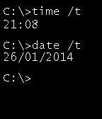</a>

<h2 class="app-name" id="app-52e64c3692c5272078000011"><a href="https://apps.repebble.com/52e64c3692c5272078000011">CMD Time</a> v1.1</h2>
<a class="app-source" href="https://github.com/C-D-Lewis/cmd-time" title="Source code" data-search-exclude>View source</a>

Watchface

No licence Released 2014-01-27 Updated 2025-08-12

Runs on: Round 2, Time 2, Pebble 2 Duo, Pebble 2, Time Round, Time, Classic

This watchface imitates the &quot;time /t&quot; and &quot;date /t&quot; commands in the Windows Command Prompt. Also includes a subtle animation on the prompt itself.

<h2 class="app-name" id="app-52f10e65af0eab7af5002d70"><a href="https://apps.repebble.com/52f10e65af0eab7af5002d70">Split Horizon: Plain Edition</a> v1.2</h2>
<a class="app-source" href="https://github.com/C-D-Lewis/split-horizon-pe" title="Source code" data-search-exclude>View source</a>

Watchface

No licence Released 2014-02-04 Updated 2025-08-08

Runs on: Time 2, Pebble 2 Duo, Pebble 2, Time, Classic

The Split Horizon: Plain Edition watchface, now for SDK 2.0. This edition has no animations at all for maximum battery life.

<a class="app-shot" href="https://apps.repebble.com/53ce41e5db5684c5fd000179" data-search-exclude>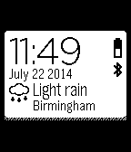</a>

<h2 class="app-name" id="app-53ce41e5db5684c5fd000179"><a href="https://apps.repebble.com/53ce41e5db5684c5fd000179">Cards</a> v1.5</h2>
<a class="app-source" href="https://github.com/C-D-Lewis/cards" title="Source code" data-search-exclude>View source</a>

Watchface

No licence Released 2014-07-22 Updated 2025-08-07

Runs on: Time 2, Pebble 2 Duo, Pebble 2, Time, Classic

Animated cards containing time, full date, battery, Bluetooth and local weather from weatherapi.com

<a class="app-shot" href="https://apps.repebble.com/53ec8d840c3036447e000109" data-search-exclude>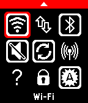</a>

<h2 class="app-name" id="app-53ec8d840c3036447e000109"><a href="https://apps.repebble.com/53ec8d840c3036447e000109">Dashboard</a> v4.8</h2>
<a class="app-source" href="https://github.com/C-D-Lewis/dashboard" title="Source code" data-search-exclude>View source</a>

App

No licence Released 2014-08-14 Updated 2016-12-26

Runs on: Round 2, Time 2, Pebble 2 Duo, Pebble 2, Time Round, Time, Classic

2026 Note: Since 2016 Google has steadily removed the ability to call many APIs required by Dashboard in the background, or without Device Admin or even root. So your mileage will vary :( This…

<a class="app-shot" href="https://apps.repebble.com/578cb2e31e00a6c4b3000312" data-search-exclude>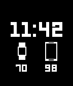</a>

<h2 class="app-name" id="app-578cb2e31e00a6c4b3000312"><a href="https://apps.repebble.com/578cb2e31e00a6c4b3000312">Dual Gauge</a> v1.4</h2>
<a class="app-source" href="https://github.com/C-D-Lewis/dual-gauge" title="Source code" data-search-exclude>View source</a>

Watchface

No licence Released 2016-07-18 Updated 2016-10-15

Runs on: Round 2, Time 2, Pebble 2 Duo, Pebble 2, Time Round, Time, Classic

Demo watchface using the Dash API to show Android battery level without a bespoke Android companion app. https://github.com/C-D-Lewis/dash-api

<a class="app-shot" href="https://apps.repebble.com/579a076222f599d627000064" data-search-exclude>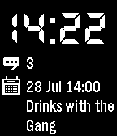</a>

<h2 class="app-name" id="app-579a076222f599d627000064"><a href="https://apps.repebble.com/579a076222f599d627000064">Eventful</a> v1.1</h2>
<a class="app-source" href="https://github.com/C-D-Lewis/eventful" title="Source code" data-search-exclude>View source</a>

Watchface

No licence Released 2016-07-28 Updated 2016-07-28

Runs on: Round 2, Time 2, Pebble 2 Duo, Pebble 2, Time Round, Time, Classic

Example watchface for the Dash API that shows unread SMS count and the next Calendar event.

<h2 class="app-name" id="app-537e6531ac5075447a00020f"><a href="https://apps.repebble.com/537e6531ac5075447a00020f">Past - Present - Future Extended</a> v1.1.0</h2>
<a class="app-source" href="https://github.com/C-D-Lewis/past-present-future-extended" title="Source code" data-search-exclude>View source</a>

Watchface

No licence Released 2014-05-22 Updated 2014-07-25

Runs on: Time 2, Pebble 2 Duo, Pebble 2, Time, Classic

The Past Present Future watchface with short date and location-aware temperate display.

<h2 class="app-name" id="app-53ce4305b40eda738a00018d"><a href="https://apps.repebble.com/53ce4305b40eda738a00018d">Index</a> v1.0.0</h2>
<a class="app-source" href="https://github.com/C-D-Lewis/index" title="Source code" data-search-exclude>View source</a>

Watchface

No licence Released 2014-07-22 Updated 2014-07-22

Runs on: Time 2, Pebble 2 Duo, Pebble 2, Time, Classic

Simple hour ^ minute index watchface.

<h2 class="app-name" id="app-53795d5062e09fef83000077"><a href="https://apps.repebble.com/53795d5062e09fef83000077">Past - Present - Future</a> v1.1.0</h2>
<a class="app-source" href="https://github.com/C-D-Lewis/past-present-future" title="Source code" data-search-exclude>View source</a>

Watchface

No licence Released 2014-05-19 Updated 2014-05-19

Runs on: Time 2, Pebble 2 Duo, Pebble 2, Time, Classic

Based on the analogue watch.

<h2 class="app-name" id="app-533b2ccf45188eb18200003c"><a href="https://apps.repebble.com/533b2ccf45188eb18200003c">Potential Divider: Large</a> v1.0.0</h2>
<a class="app-source" href="https://github.com/C-D-Lewis/divider-large-2" title="Source code" data-search-exclude>View source</a>

Watchface

No licence Released 2014-04-01 Updated 2014-04-01

Runs on: Time 2, Pebble 2 Duo, Pebble 2, Time, Classic

The Potential Divider watchface, but with a larger font. For space reasons, the output voltage is now limited to one digit.

<a class="app-shot" href="https://apps.repebble.com/5315eb142604411a0800026e" data-search-exclude>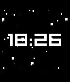</a>

<h2 class="app-name" id="app-5315eb142604411a0800026e"><a href="https://apps.repebble.com/5315eb142604411a0800026e">Starfield Power Saver</a> v1.0.0</h2>
<a class="app-source" href="https://github.com/C-D-Lewis/starfield" title="Source code" data-search-exclude>View source</a>

Watchface

No licence Released 2014-03-04 Updated 2014-03-04

Runs on: Time 2, Pebble 2 Duo, Pebble 2, Time, Classic

The Starfield Smooth watchface, but with a lower frame-rate to save power. Randomness still included!

<h2 class="app-name" id="app-5315e6c13184b483160001e5"><a href="https://apps.repebble.com/5315e6c13184b483160001e5">Starfield Graphics Demo</a> v1.0.0</h2>
<a class="app-source" href="https://github.com/C-D-Lewis/starfield-demo" title="Source code" data-search-exclude>View source</a>

App

No licence Released 2014-03-04 Updated 2014-03-04

Runs on: Time 2, Pebble 2 Duo, Pebble 2, Time, Classic

This is a simple graphics demo showing randomly generated stars flying across the display at 30 FPS

<h2 class="app-name" id="app-52f10dc8af0eab7af5002d54"><a href="https://apps.repebble.com/52f10dc8af0eab7af5002d54">Split Horizon: Minutes Edition</a> v1.0.0</h2>
<a class="app-source" href="https://github.com/C-D-Lewis/split-horizon-me" title="Source code" data-search-exclude>View source</a>

Watchface

No licence Released 2014-02-04 Updated 2014-02-04

Runs on: Time 2, Pebble 2 Duo, Pebble 2, Time, Classic

The Split Horizon: Minutes Edition watch face, now for SDK 2.0. This watchface includes the same animation as the Seconds Edition, but only on the minute change.

<a class="app-shot" href="https://apps.repebble.com/52cd48ecc296577c6c00002f" data-search-exclude>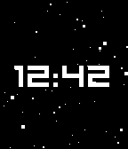</a>

<h2 class="app-name" id="app-52cd48ecc296577c6c00002f"><a href="https://apps.repebble.com/52cd48ecc296577c6c00002f">Starfield Smooth</a> v1.0.0</h2>
<a class="app-source" href="https://github.com/C-D-Lewis/starfield-smooth" title="Source code" data-search-exclude>View source</a>

Watchface

No licence Released 2014-01-08 Updated 2014-01-08

Runs on: Time 2, Pebble 2 Duo, Pebble 2, Time, Classic

A super-smooth 30FPS animated watchface with a background of randomly generated stars with a depth illusion.

