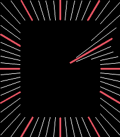

<!-- Generated by scripts/update_app_directory.py: do not edit by hand -->
[← All Pebble Developers](../developers.md)

# Chris Mondok

*1 watchface · Last updated 2026-10-11 · [About these lists](../about-app-lists.md)*

Links: [Pebble App Store](https://apps.repebble.com/apps/dev/chris-mondok_c9d0fd35867b0a0b127d4d29) · [GitHub (ChrisMondok)](https://github.com/ChrisMondok)

<h2 class="app-name" id="app-6999fb27f7e14b1986ebd366"><a href="https://apps.repebble.com/6999fb27f7e14b1986ebd366">Magnetism</a> v1.0.0</h2>
<a class="app-source" href="https://github.com/ChrisMondok/magnetism" title="Source code" data-search-exclude>View source</a>

Watchface

No licence Released 2026-06-28 Updated 2026-06-28

Runs on: Round 2, Time 2, Pebble 2 Duo, Pebble 2, Time Round, Time, Classic

A Pebble watchface with no hands. The graduations tell the time.

