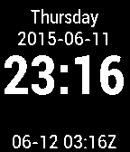

<!-- Generated by scripts/update_app_directory.py: do not edit by hand -->
[← All Pebble Developers](../developers.md)

# Chris Perelstein

*1 watchface · Last updated 2026-10-11 · [About these lists](../about-app-lists.md)*

Links: [Pebble App Store](https://apps.repebble.com/apps/dev/chris-perelstein_5575a255b600bdb9bf00002b) · [GitHub (chrisperelstein)](https://github.com/chrisperelstein)

<h2 class="app-name" id="app-557b4e42bae817ca0b000080"><a href="https://apps.repebble.com/557b4e42bae817ca0b000080">basic plus utc</a> v1.1</h2>
<a class="app-source" href="https://github.com/chrisperelstein/basic_plus_utc" title="Source code" data-search-exclude>View source</a>

Watchface

Released 2015-06-12 Updated 2015-08-24

Runs on: Time 2, Pebble 2 Duo, Pebble 2, Time, Classic

Basic watchface with UTC date and time at the bottom.

