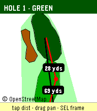

<!-- Generated by scripts/update_app_directory.py: do not edit by hand -->
[← All Pebble Developers](../developers.md)

# Chris Snyder

*1 app · Last updated 2026-10-12 · [About these lists](../about-app-lists.md)*

Links: [Pebble App Store](https://apps.repebble.com/apps/dev/chris-snyder_f23977cddca91c4889074295) · [GitHub (chrissnyder2337)](https://github.com/chrissnyder2337)

<h2 class="app-name" id="app-57f80ba0bfbe4ad7a44dbbcf"><a href="https://apps.repebble.com/57f80ba0bfbe4ad7a44dbbcf">Pebble Golf</a> v1.7.0</h2>
<a class="app-source" href="https://github.com/chrissnyder2337/pebble-golf" title="Source code" data-search-exclude>View source</a>

App · <a href="https://forum.rebble.io/t/1064" title="Discuss this app on the Rebble forum" data-search-exclude>Forum thread</a>

No licence Released 2026-06-18 Updated 2026-09-30

Runs on: Round 2, Time 2, Pebble 2 Duo, Pebble 2, Time Round, Time

Pebble Golf turns your watch into a golf rangefinder, digital scorecard, and tap-to-measure course map, all live on your wrist. Supported languages: English, Français, Deutsch, Español, Italiano…

