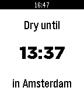

<!-- Generated by scripts/update_app_directory.py: do not edit by hand -->
[← All Pebble Developers](../developers.md)

# chris

*1 watchface and 1 app · Last updated 2026-10-11 · [About these lists](../about-app-lists.md)*

Links: [Pebble App Store](https://apps.repebble.com/apps/dev/chris_5325af5f8f1b377345000157) · [GitHub (dunamis)](https://github.com/dunamis)

<button type="button" data-filter="all" aria-pressed="true">All 2</button><button type="button" data-filter="watchface" aria-pressed="false">Watchfaces 1</button><button type="button" data-filter="watchapp" aria-pressed="false">Apps 1</button>

<label class="dev-sort">Sort by <select><option value="updated">Recently updated</option><option value="released">Newest release</option><option value="title">A–Z</option></select></label>

<h2 class="app-name" id="app-536e3c760937dee0df0000c6"><a href="https://apps.repebble.com/536e3c760937dee0df0000c6">Dry Until</a> v1.0.2</h2>
<a class="app-source" href="https://github.com/dunamis/pebble/tree/master/watchapps/dryuntil" title="Source code" data-search-exclude>View source</a>

App

Released 2014-05-10 Updated 2014-06-09

Runs on: Time 2, Pebble 2 Duo, Pebble 2, Time, Classic

This app shows at what time the next rain shower is expected for your location in, using data from buienradar.nl.

<h2 class="app-name" id="app-53666f0114acdb643000007f"><a href="https://apps.repebble.com/53666f0114acdb643000007f">Full Circle</a> v1.0.1</h2>
<a class="app-source" href="https://github.com/dunamis/pebble/tree/master/watchfaces/fullcircle" title="Source code" data-search-exclude>View source</a>

Watchface

Released 2014-05-04 Updated 2014-05-10

Runs on: Time 2, Pebble 2 Duo, Pebble 2, Time, Classic

A clean and intuitive watchface that shows the minutes as a progressing circle, with the hour in text in the center. Shake or tap your Pebble to view the date instead of the hour.

