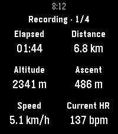

<!-- Generated by scripts/update_app_directory.py: do not edit by hand -->
[← All Pebble Developers](../developers.md)

# Christian Herget

*1 app · Last updated 2026-10-11 · [About these lists](../about-app-lists.md)*

Links: [Pebble App Store](https://apps.repebble.com/apps/dev/christian-herget_6a8e09c95d9d660008a3f511) · [GitHub (ChristianHerget)](https://github.com/ChristianHerget) · [Website (christianherget.github.io)](https://christianherget.github.io/trackglance/)

<h2 class="app-name" id="app-6a8e0fd8f97a9e000a7e475b"><a href="https://apps.repebble.com/6a8e0fd8f97a9e000a7e475b">TrackGlance</a> v0.2.6</h2>
<a class="app-source" href="https://github.com/ChristianHerget/trackglance" title="Source code" data-search-exclude>View source</a>

App

Other Released 2026-08-25 Updated 2026-08-27

Runs on: Round 2, Time 2

View and control Locus Map track recordings from a Pebble Time 2 or Pebble Round 2. TrackGlance brings an active Locus Map track recording to your wrist. Choose the metrics shown for each Locus…

