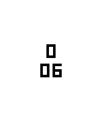

<!-- Generated by scripts/update_app_directory.py: do not edit by hand -->
[← All Pebble Developers](../developers.md)

# Christian Ratzenhofer

*1 app · Last updated 2026-10-11 · [About these lists](../about-app-lists.md)*

Links: [Pebble App Store](https://apps.repebble.com/apps/dev/christian-ratzenhofer_cf8cc0e01f5fd63901765dc1) · [GitHub (merlin1991)](https://github.com/merlin1991)

<h2 class="app-name" id="app-d6c906fae28743d8be2aa4c0"><a href="https://apps.repebble.com/d6c906fae28743d8be2aa4c0">Find Watch 2</a> v2.1.0</h2>
<a class="app-source" href="https://github.com/merlin1991/pebble-findwatch2" title="Source code" data-search-exclude>View source</a>

App

Released 2026-07-29 Updated 2026-08-25

Runs on: Round 2, Time 2, Pebble 2 Duo, Pebble 2, Time Round, Time, Classic

Can&#x27;t find your Pebble? If it is still within bluetooth reach and your phone/pad is connected to your watch, installing this app will make your watch vibrate, flash, and beep (on watches with…

