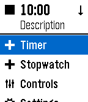
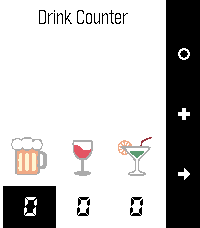
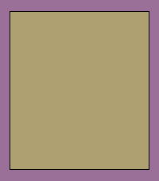
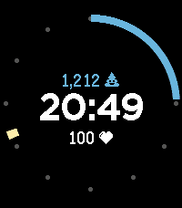
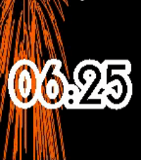

<!-- Generated by scripts/update_app_directory.py: do not edit by hand -->
[← All Pebble Developers](../developers.md)

# Christian Reinbacher

*6 watchfaces and 4 apps · Last updated 2026-10-12 · [About these lists](../about-app-lists.md)*

Links: [Pebble App Store](https://apps.repebble.com/apps/dev/christian-reinbacher_52d29655c44c044e9f00004f) · [GitHub (reini1305)](https://github.com/reini1305) · [Website (reini1305.github.io)](http://reini1305.github.io/)

<button type="button" data-filter="all" aria-pressed="true">All 10</button><button type="button" data-filter="watchface" aria-pressed="false">Watchfaces 6</button><button type="button" data-filter="watchapp" aria-pressed="false">Apps 4</button>

<label class="dev-sort">Sort by <select><option value="updated">Recently updated</option><option value="released">Newest release</option><option value="title">A–Z</option></select></label>

<h2 class="app-name" id="app-5814a5a946041f90f4000161"><a href="https://apps.repebble.com/5814a5a946041f90f4000161">Multi Timer ++</a> v1.9-rbl1</h2>
<a class="app-source" href="https://github.com/reini1305/multi-timer" title="Source code" data-search-exclude>View source</a>

App

Released 2016-10-29 Updated 2019-07-24

Runs on: Round 2, Time 2, Pebble 2 Duo, Pebble 2, Time Round, Time

This is a remix of the Multi-Timer app of Matthew Tole with a few added features: - Set descriptions for each timer - Dictate descriptions - Timeline Support (for the next timer) - AppGlance…

<h2 class="app-name" id="app-554b93a25fa04f7f3f000058"><a href="https://apps.repebble.com/554b93a25fa04f7f3f000058">Drink Counter</a> v7.1-rbl1</h2>
<a class="app-source" href="https://github.com/reini1305/drinkcounter" title="Source code" data-search-exclude>View source</a>

App

Released 2015-05-07 Updated 2019-07-24

Runs on: Round 2, Time 2, Pebble 2 Duo, Pebble 2, Time Round, Time, Classic

Drink Counter allows you to keep track of your alcohol, water and cigarette consumption. It even estimates the blood alcohol level based on your gender, weight and number of drinks. Remember…

<h2 class="app-name" id="app-54551598997cdfddaa000043"><a href="https://apps.repebble.com/54551598997cdfddaa000043">Alarms++</a> v7.7-rbl1</h2>
<a class="app-source" href="https://github.com/reini1305/alarmsplusplus" title="Source code" data-search-exclude>View source</a>

App

Released 2014-11-01 Updated 2019-07-24

Runs on: Round 2, Time 2, Pebble 2 Duo, Pebble 2, Time Round, Time, Classic

This app is open source! If you like my apps heart them in the appstore and consider a donation (link is at the source link of this app). With Alarms++ you can flexibly schedule up to 24 alarms on…

<h2 class="app-name" id="app-5803cc5cc98866548c000141"><a href="https://apps.repebble.com/5803cc5cc98866548c000141">Clean Cut</a> v1.17</h2>
<a class="app-source" href="https://github.com/reini1305/cutting_edge" title="Source code" data-search-exclude>View source</a>

Watchface

Released 2016-10-16 Updated 2016-11-26

Runs on: Round 2, Time 2, Pebble 2 Duo, Pebble 2, Time Round, Time, Classic

Made due to a reddit request from /u/stegosaurusflex1 (who also gets the design credits). You can freely select the colors of hour, minute, background and seperator. The font is called &quot;Peace…

<h2 class="app-name" id="app-5788ce3884accc5dac000009"><a href="https://apps.repebble.com/5788ce3884accc5dac000009">Time Less</a> v1.5</h2>
<a class="app-source" href="https://github.com/reini1305/timeless" title="Source code" data-search-exclude>View source</a>

Watchface

Released 2016-07-15 Updated 2016-10-24

Runs on: Round 2, Time 2, Time Round, Time

Do you feel stressed when looking at your watch? With this watchface this won&#x27;t happen anymore. It shows the time using simple colors, one color displacing the other while the hour passes by. If…

<h2 class="app-name" id="app-5800edb0d43cb3a62e000001"><a href="https://apps.repebble.com/5800edb0d43cb3a62e000001">StriderHR</a> v1.8</h2>
<a class="app-source" href="https://github.com/reini1305/strider-watchface" title="Source code" data-search-exclude>View source</a>

Watchface

Released 2016-10-14 Updated 2016-10-24

Runs on: Round 2, Time 2, Pebble 2 Duo, Pebble 2, Time Round, Time

This is a clone of the Pebble watchface Strider, based on the original source code. This modified version adds support for Pebble 2 and a few layout tweaks compared to the original.

<h2 class="app-name" id="app-535e84d0af59179a46000088"><a href="https://apps.repebble.com/535e84d0af59179a46000088">QR Generator</a> v2.3</h2>
<a class="app-source" href="https://github.com/reini1305/qrgenerator" title="Source code" data-search-exclude>View source</a>

App

Released 2014-04-28 Updated 2016-10-24

Runs on: Round 2, Time 2, Pebble 2 Duo, Pebble 2, Time Round, Time, Classic

This app is open source! If you like my apps heart them in the appstore and consider a donation (link is at the source link of this app). Displays your business card or any string as QR code on…

<h2 class="app-name" id="app-5659b0dc36f882e860000055"><a href="https://apps.repebble.com/5659b0dc36f882e860000055">Fun with flags</a> v2.2</h2>
<a class="app-source" href="https://github.com/reini1305/funwithflags" title="Source code" data-search-exclude>View source</a>

Watchface

Released 2015-11-28 Updated 2016-10-24

Runs on: Round 2, Time 2, Time Round, Time

Learn some new flags on the go! Every minute a new flag is shown. if you flick your wrist, your watch will tell you which country the flag belongs to. If you like it, give it a heart and consider…

<h2 class="app-name" id="app-5588e2fdef446dab8f000061"><a href="https://apps.repebble.com/5588e2fdef446dab8f000061">Fireworks</a> v2.1</h2>
<a class="app-source" href="https://github.com/reini1305/fireworks" title="Source code" data-search-exclude>View source</a>

Watchface

Released 2015-06-23 Updated 2016-10-24

Runs on: Round 2, Time 2, Pebble 2 Duo, Pebble 2, Time Round, Time, Classic

Fireworks on your Pebble every minute! Shake to firework! (Both configurable of course) It also features a &quot;nightstand mode&quot;. When you put the watch on it&#x27;s side, it just displays the time in the…

<h2 class="app-name" id="app-55997be0a3e668a6ea000063"><a href="https://apps.repebble.com/55997be0a3e668a6ea000063">Digilog</a> v2.1</h2>
<a class="app-source" href="https://github.com/reini1305/digilog" title="Source code" data-search-exclude>View source</a>

Watchface

Released 2015-07-05 Updated 2016-10-24

Runs on: Round 2, Time 2, Pebble 2 Duo, Pebble 2, Time Round, Time, Classic

Digilog is open source. If you like it, give it a heart and consider a donation (link is at the website linked down below). Simple combination of analog and digital watchface. The hours are shown…

