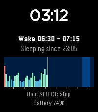

<!-- Generated by scripts/update_app_directory.py: do not edit by hand -->
[← All Pebble Developers](../developers.md)

# Christian Sandmann

*1 app · Last updated 2026-10-12 · [About these lists](../about-app-lists.md)*

Links: [Pebble App Store](https://apps.repebble.com/apps/dev/christian-sandmann_9d2c878e46f2688f42910d40) · [GitHub (JamesFowler42)](https://github.com/JamesFowler42)

<h2 class="app-name" id="app-40186d90c77b46789c25a1e3"><a href="https://apps.repebble.com/40186d90c77b46789c25a1e3">Morpheuz Reborn</a> v1.5.1</h2>
<a class="app-source" href="https://github.com/JamesFowler42/morpheuz20" title="Source code" data-search-exclude>View source</a>

App

Other Released 2026-10-11 Updated 2026-10-12

Runs on: Round 2, Time 2

Morpheuz Reborn is a sleep monitor with a smart alarm. It is a ground-up rebuild of the original Morpheuz by James Fowler (MIT licence), whose servers are gone…

