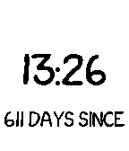

<!-- Generated by scripts/update_app_directory.py: do not edit by hand -->
[← All Pebble Developers](../developers.md)

# ChristianD

*1 watchface · Last updated 2026-10-12 · [About these lists](../about-app-lists.md)*

Links: [Rebble App Store](https://apps.rebble.io/en_US/developer/56a28b05956f0b4d4c000055/1) · [GitHub (laDanz)](https://github.com/laDanz)

<h2 class="app-name" id="app-58c3fb980dfc32a52a000893"><a href="https://apps.rebble.io/en_US/application/58c3fb980dfc32a52a000893">days since / til</a> v1.2</h2>
<a class="app-source" href="https://github.com/laDanz/days-since-til" title="Source code" data-search-exclude>View source</a>

Watchface

Released 2017-03-11 Updated 2017-03-16 Rebble App Store

Runs on: Time 2, Pebble 2 Duo, Pebble 2, Time, Classic

Showing the time, and the days since your personal special date and the days til your next anniversary. If date provided in settings is not in the future, your display switches every minute…

