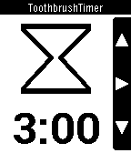

<!-- Generated by scripts/update_app_directory.py: do not edit by hand -->
[← All Pebble Developers](../developers.md)

# Christoph

*1 app · Last updated 2026-10-12 · [About these lists](../about-app-lists.md)*

Links: [Pebble App Store](https://apps.repebble.com/apps/dev/christoph_52ac48d219ff50a813000002) · [Website (christophhaefner.de)](http://christophhaefner.de/pebble/)

<h2 class="app-name" id="app-52aca26019ff50f332000016"><a href="https://apps.repebble.com/52aca26019ff50f332000016">Toothbrushtimer</a> v2.2</h2>
<a class="app-source" href="http://gitlab.christophhaefner.de/pebble/toothbrushtimer" title="Source code" data-search-exclude>View source</a>

App

Released 2013-12-14 Updated 2015-03-09

Runs on: Time 2, Pebble 2 Duo, Pebble 2, Time, Classic

Basically a digital version of the little sandglass I had when I was a kid to ensure I&#x27;m toothbrushing a proper amount of time. http://christophhaefner.de/pebble/

