<!-- Generated by scripts/update_app_directory.py: do not edit by hand -->
[← All Pebble Developers](../developers.md)

# Christophe Jeannette

*8 watchfaces and 7 apps · Last updated 2026-10-11 · [About these lists](../about-app-lists.md)*

Links: [Pebble App Store](https://apps.repebble.com/apps/dev/christophe-jeannette_54edf0599e4ff7cbf60000a0) · [GitHub (Sichroteph)](https://github.com/Sichroteph) · [Website (reddit.com)](https://www.reddit.com/r/pebble/comments/436det/time_graph_ruler_weather_major_update/)

<button type="button" data-filter="all" aria-pressed="true">All 15</button><button type="button" data-filter="watchface" aria-pressed="false">Watchfaces 8</button><button type="button" data-filter="watchapp" aria-pressed="false">Apps 7</button>

<label class="dev-sort">Sort by <select><option value="updated">Recently updated</option><option value="released">Newest release</option><option value="title">A–Z</option></select></label>

<a class="app-shot" href="https://apps.repebble.com/56a55e2511d0acce1000006a" data-search-exclude>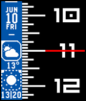</a>

<h2 class="app-name" id="app-56a55e2511d0acce1000006a"><a href="https://apps.repebble.com/56a55e2511d0acce1000006a">Ruler Weather</a> v6.35</h2>
<a class="app-source" href="https://github.com/Sichroteph/Ruler-Weather2" title="Source code" data-search-exclude>View source</a>

Watchface · <a href="https://forum.rebble.io/t/708" title="Discuss this app on the Rebble forum" data-search-exclude>Forum thread</a>

No licence Released 2016-01-24 Updated 2026-07-28

Runs on: Round 2, Time 2, Pebble 2 Duo, Pebble 2, Time Round, Time, Classic

An very detailed weather access on your wrist, with an original way of telling the time. Battery efficient (Pebble gave the A-grade rating) and a tons of customisation ! Automatic 12/24h, 4…

<h2 class="app-name" id="app-65c20b964e72c30009761e85"><a href="https://apps.repebble.com/65c20b964e72c30009761e85">TimePulse</a> v1.02</h2>
<a class="app-source" href="https://github.com/Sichroteph/Nag_for_Pebble" title="Source code" data-search-exclude>View source</a>

App

MIT Released 2024-02-06 Updated 2026-07-14

Runs on: Time 2, Pebble 2 Duo, Pebble 2, Time, Classic

Time Pulse is a practical timekeeping app designed to assist you throughout your day. - With Time Pulse, you can set specific intervals for notifications, helping you stay aware of the passing…

<a class="app-shot" href="https://apps.repebble.com/69b1ef8172240d000a726e3a" data-search-exclude>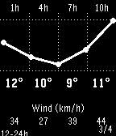</a>

<h2 class="app-name" id="app-69b1ef8172240d000a726e3a"><a href="https://apps.repebble.com/69b1ef8172240d000a726e3a">Keystone</a> v1.7</h2>
<a class="app-source" href="https://github.com/Sichroteph/Din-Clean-App" title="Source code" data-search-exclude>View source</a>

App · <a href="https://forum.rebble.io/t/764" title="Discuss this app on the Rebble forum" data-search-exclude>Forum thread</a>

No licence Released 2026-03-11 Updated 2026-03-24

Runs on: Time 2, Pebble 2 Duo, Pebble 2, Time, Classic

Keystone turns your Pebble into a fully button-driven hub. It looks like a watchface, but every button is yours. Short press opens custom menus or widgets. Long press fires a Home Assistant…

<a class="app-shot" href="https://apps.repebble.com/69ab4a4c2f77690009cb2a0e" data-search-exclude>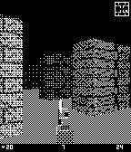</a>

<h2 class="app-name" id="app-69ab4a4c2f77690009cb2a0e"><a href="https://apps.repebble.com/69ab4a4c2f77690009cb2a0e">Last Corridor</a> v1.0</h2>
<a class="app-source" href="https://github.com/Sichroteph/Last-Corridor" title="Source code" data-search-exclude>View source</a>

App · <a href="https://forum.rebble.io/t/749" title="Discuss this app on the Rebble forum" data-search-exclude>Forum thread</a>

No licence Released 2026-03-06 Updated 2026-03-06

Runs on: Time 2, Pebble 2 Duo, Pebble 2, Time, Classic

You&#x27;re trapped in a hostile facility overrun by alien creatures. Move through the corridors, find and shoot every enemy before they reach you. Survive long enough to clear the level. Controls: up…

<a class="app-shot" href="https://apps.repebble.com/63555cd1b9710000096ea5f8" data-search-exclude>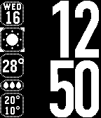</a>

<h2 class="app-name" id="app-63555cd1b9710000096ea5f8"><a href="https://apps.repebble.com/63555cd1b9710000096ea5f8">Din clean</a> v1.60</h2>
<a class="app-source" href="https://github.com/Sichroteph/Din-Clean" title="Source code" data-search-exclude>View source</a>

Watchface · <a href="https://forum.rebble.io/t/404" title="Discuss this app on the Rebble forum" data-search-exclude>Forum thread</a>

No licence Released 2022-10-23 Updated 2026-03-05

Runs on: Time 2, Pebble 2 Duo, Pebble 2, Time, Classic

A clean and elegant watchface for Pebble watches, designed for instant access to essential information with focus on readability and simplicity. Key features: Clear time display with large digits…

<a class="app-shot" href="https://apps.repebble.com/56b15425000ea69de500003b" data-search-exclude>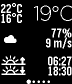</a>

<h2 class="app-name" id="app-56b15425000ea69de500003b"><a href="https://apps.repebble.com/56b15425000ea69de500003b">Weather Graph</a> v3.0</h2>
<a class="app-source" href="https://github.com/Sichroteph/Weather-Graph" title="Source code" data-search-exclude>View source</a>

App · <a href="https://forum.rebble.io/t/492" title="Discuss this app on the Rebble forum" data-search-exclude>Forum thread</a>

No licence Released 2016-02-03 Updated 2026-01-14

Runs on: Round 2, Time 2, Pebble 2 Duo, Pebble 2, Time Round, Time, Classic

Display a graph for the upcoming 24 hours, showing details on temperature, rain precipitation, and wind speed. The interface consists of 7 screens, starting from current conditions, progressing…

<a class="app-shot" href="https://apps.repebble.com/695cea36ccb618000951b01b" data-search-exclude>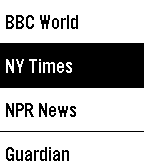</a>

<h2 class="app-name" id="app-695cea36ccb618000951b01b"><a href="https://apps.repebble.com/695cea36ccb618000951b01b">FlashRead News</a> v1.9</h2>
<a class="app-source" href="https://github.com/Sichroteph/RSVP-Breaking-News" title="Source code" data-search-exclude>View source</a>

App · <a href="https://forum.rebble.io/t/449" title="Discuss this app on the Rebble forum" data-search-exclude>Forum thread</a>

No licence Released 2026-01-06 Updated 2026-01-12

Runs on: Time 2, Pebble 2 Duo, Pebble 2, Time, Classic

FlashRead News brings RSS feeds to your Pebble using RSVP (Rapid Serial Visual Presentation), a proven speed-reading technique that displays words one at a time, centered on the optimal…

<a class="app-shot" href="https://apps.repebble.com/687e65a16248550009699f0c" data-search-exclude>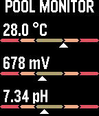</a>

<h2 class="app-name" id="app-687e65a16248550009699f0c"><a href="https://apps.repebble.com/687e65a16248550009699f0c">Pool Monitor</a> v1.2</h2>
<a class="app-source" href="https://github.com/Sichroteph/PoolMonitor" title="Source code" data-search-exclude>View source</a>

App

Apache-2.0 Released 2025-07-21 Updated 2025-07-22

Runs on: Time 2, Pebble 2 Duo, Pebble 2, Time, Classic

This application enables the use of the IoPool pool probe API to extract data on water temperature, oxidation level, and pH.

<h2 class="app-name" id="app-6552038de46ef100098b1e06"><a href="https://apps.repebble.com/6552038de46ef100098b1e06">Revolution Steel</a> v4.0</h2>
<a class="app-source" href="https://github.com/Sichroteph/Another_Revolution/tree/Pebble__steel" title="Source code" data-search-exclude>View source</a>

Watchface

No licence Released 2023-11-13 Updated 2023-11-13

Runs on: Time 2, Pebble 2 Duo, Pebble 2, Time, Classic

This version of the Revolution watch face is a straightforward modification where the time and date switch places, and the seconds are replaced with the battery percentage.

<a class="app-shot" href="https://apps.repebble.com/57e222e263ae13bb79000011" data-search-exclude>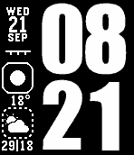</a>

<h2 class="app-name" id="app-57e222e263ae13bb79000011"><a href="https://apps.repebble.com/57e222e263ae13bb79000011">Impact</a> v1.12</h2>
<a class="app-source" href="https://github.com/Sichroteph/Impact" title="Source code" data-search-exclude>View source</a>

Watchface

No licence Released 2016-09-21 Updated 2019-08-04

Runs on: Round 2, Time 2, Pebble 2 Duo, Pebble 2, Time Round, Time, Classic

A watchface that use the Impact font with detailed weather informations. Features : - Pebble battery - Phone battery (Android) - Immediate weather temperature and conditions - 6 Hours weather…

<a class="app-shot" href="https://apps.repebble.com/56e89ef0621418c0c1000022" data-search-exclude>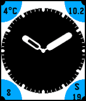</a>

<h2 class="app-name" id="app-56e89ef0621418c0c1000022"><a href="https://apps.repebble.com/56e89ef0621418c0c1000022">Vinyl</a> v2.8</h2>
<a class="app-source" href="https://github.com/Sichroteph/Vinyl" title="Source code" data-search-exclude>View source</a>

Watchface

No licence Released 2016-03-15 Updated 2018-02-04

Runs on: Round 2, Time 2, Pebble 2 Duo, Pebble 2, Time Round, Time, Classic

Now with forecast.io temperature ! Vinyl is an analog watchface designed to be elegant and readable. Informations : - Temperature - Battery (0-&gt;10) - Date 4 languages, color management, hourly…

<h2 class="app-name" id="app-57cd7bd4f69d1dff8d000352"><a href="https://apps.repebble.com/57cd7bd4f69d1dff8d000352">Another Revolution</a> v2.0</h2>
<a class="app-source" href="https://github.com/Sichroteph/Another_Revolution" title="Source code" data-search-exclude>View source</a>

Watchface

No licence Released 2016-09-05 Updated 2016-09-05

Runs on: Time 2, Pebble 2 Duo, Pebble 2, Time, Classic

Implemented by Douwe Maan. Slightly modified by Christophe Jeannette in order to add : Slicker animations Battery instead of the seconds (Battery friendly) Two automatic languages : English and…

<a class="app-shot" href="https://apps.repebble.com/5722a9907adf6b48cf000018" data-search-exclude>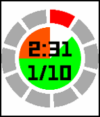</a>

<h2 class="app-name" id="app-5722a9907adf6b48cf000018"><a href="https://apps.repebble.com/5722a9907adf6b48cf000018">Running assistant</a> v1.1</h2>
<a class="app-source" href="https://github.com/Sichroteph/Running-Assistant" title="Source code" data-search-exclude>View source</a>

App

No licence Released 2016-04-29 Updated 2016-04-29

Runs on: Round 2, Time 2, Pebble 2 Duo, Pebble 2, Time Round, Time, Classic

This app is specifically designed to help new joggers to gradualy start running, or to confort moderate joggers to reinforce their pace. Working with intervals, the app will strongly vibrate when…

<a class="app-shot" href="https://apps.repebble.com/56fd939f34e0e2225900000a" data-search-exclude>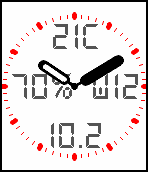</a>

<h2 class="app-name" id="app-56fd939f34e0e2225900000a"><a href="https://apps.repebble.com/56fd939f34e0e2225900000a">All-In</a> v1.2</h2>
<a class="app-source" href="https://github.com/Sichroteph/All-In-One2" title="Source code" data-search-exclude>View source</a>

Watchface

No licence Released 2016-03-31 Updated 2016-04-04

Runs on: Round 2, Time 2, Pebble 2 Duo, Pebble 2, Time Round, Time, Classic

Keep all your important informations in one stylish analog/digital watchface. Data displayed: - Time (No kidding !) - Current weather (Provided by Forecast.io) - Weekday - Day of the month …

<h2 class="app-name" id="app-56a55842fce09005ad000078"><a href="https://apps.repebble.com/56a55842fce09005ad000078">Time Graph Weather</a> v5.2</h2>
<a class="app-source" href="https://github.com/Sichroteph/Time-Graph" title="Source code" data-search-exclude>View source</a>

Watchface

No licence Released 2016-01-24 Updated 2016-02-14

Runs on: Round 2, Time 2, Pebble 2 Duo, Pebble 2, Time Round, Time, Classic

This is Time Graph Weather, a representation of the next 12 hours of weather forecast at a glance. The rain is represented with the vertical lines, one raw in 1mm of expected precipitations. The…

