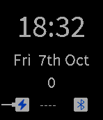

<!-- Generated by scripts/update_app_directory.py: do not edit by hand -->
[← All Pebble Developers](../developers.md)

# Christopher Frost

*1 watchface · Last updated 2026-10-11 · [About these lists](../about-app-lists.md)*

Links: [Pebble App Store](https://apps.repebble.com/apps/dev/christopher-frost_550ab580abca23f36800010b) · [GitHub (cgfrost)](https://github.com/cgfrost)

<h2 class="app-name" id="app-576835410cc8f53b430003a5"><a href="https://apps.repebble.com/576835410cc8f53b430003a5">Octant</a> v1.4</h2>
<a class="app-source" href="https://github.com/cgfrost/octant" title="Source code" data-search-exclude>View source</a>

Watchface

Released 2016-06-20 Updated 2016-10-17

Runs on: Round 2, Time 2, Pebble 2 Duo, Pebble 2, Time Round, Time

Simple watch face that uses Jolla style font and icons.

