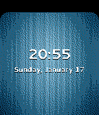

<!-- Generated by scripts/update_app_directory.py: do not edit by hand -->
[← All Pebble Developers](../developers.md)

# Christopher K. Horton

*1 watchface · Last updated 2026-10-11 · [About these lists](../about-app-lists.md)*

Links: [Pebble App Store](https://apps.repebble.com/apps/dev/christopher-k-horton_5334320609f59886580001e3) · [GitHub (WarriorIng64)](https://github.com/WarriorIng64)

<h2 class="app-name" id="app-569c4e24d05afe97f1000075"><a href="https://apps.repebble.com/569c4e24d05afe97f1000075">GNOME 3</a> v1.0</h2>
<a class="app-source" href="https://github.com/WarriorIng64/GNOME-3-Watchface" title="Source code" data-search-exclude>View source</a>

Watchface

GPL-3.0 Released 2016-01-18 Updated 2016-01-18

Runs on: Time 2, Time

This watchface is inspired by the lockscreen for the GNOME 3 desktop environment. You can make it look like you&#x27;re running one of the most popular Linux desktop environments right on your…

