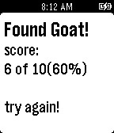

<!-- Generated by scripts/update_app_directory.py: do not edit by hand -->
[← All Pebble Developers](../developers.md)

# Christopher McCulloh

*1 app · Last updated 2026-10-12 · [About these lists](../about-app-lists.md)*

Links: [Pebble App Store](https://apps.repebble.com/apps/dev/christopher-mcculloh_53876b22ce37d4bb16000160) · [GitHub (cmcculloh)](https://github.com/cmcculloh) · [Website (en.wikipedia.org)](http://en.wikipedia.org/wiki/Monty_Hall_problem)

<h2 class="app-name" id="app-5389ccd2b773456af50000cc"><a href="https://apps.repebble.com/5389ccd2b773456af50000cc">Monty Hall Problem</a> v1.0</h2>
<a class="app-source" href="https://github.com/cmcculloh/pebble-hall" title="Source code" data-search-exclude>View source</a>

App

MIT Released 2014-05-31 Updated 2014-05-31

Runs on: Time 2, Pebble 2 Duo, Pebble 2, Time, Classic

A goat is hidden behind one of three doors. Select a door and the watch will open one of the two other doors (that doesn&#x27;t have the goat). Now select again. Will you switch doors or keep your…

