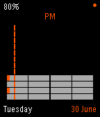

<!-- Generated by scripts/update_app_directory.py: do not edit by hand -->
[← All Pebble Developers](../developers.md)

# Christopher Waite

*1 watchface · Last updated 2026-10-11 · [About these lists](../about-app-lists.md)*

Links: [Pebble App Store](https://apps.repebble.com/apps/dev/christopher-waite_5575e66ebea9cc922b000050) · [GitHub (chrismwaite)](https://github.com/chrismwaite) · [Website (bytesizeadventures.com)](http://www.bytesizeadventures.com/)

<h2 class="app-name" id="app-558593636b9455d89e0000f0"><a href="https://apps.repebble.com/558593636b9455d89e0000f0">Equaliser</a> v1.5</h2>
<a class="app-source" href="https://github.com/chrismwaite/equaliser" title="Source code" data-search-exclude>View source</a>

Watchface

Released 2015-06-20 Updated 2015-07-01

Runs on: Time 2, Pebble 2 Duo, Pebble 2, Time, Classic

Equaliser is a new take on telling the time. It has the following features: - Battery level display - Day of the week and date - Bluetooth connectivity indicator (with vibrate on…

