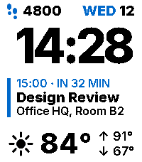

<!-- Generated by scripts/update_app_directory.py: do not edit by hand -->
[← All Pebble Developers](../developers.md)

# chrizel

*1 watchface · Last updated 2026-10-11 · [About these lists](../about-app-lists.md)*

Links: [Pebble App Store](https://apps.repebble.com/apps/dev/chrizel_e680f3182a066dc5d559126d) · [GitHub (chrizel)](https://github.com/chrizel)

<h2 class="app-name" id="app-e7e6e7aac1e24f90b0c8d43b"><a href="https://apps.repebble.com/e7e6e7aac1e24f90b0c8d43b">Almanac</a> v1.3.0</h2>
<a class="app-source" href="https://github.com/chrizel/Almanac" title="Source code" data-search-exclude>View source</a>

Watchface

Released 2026-08-28 Updated 2026-09-07

Runs on: Time 2

A calm watchface built around the two things you actually look down for: what&#x27;s coming up, and what the sky is doing. Three blocks on a plain field, nothing else. DATE - weekday and day number…

