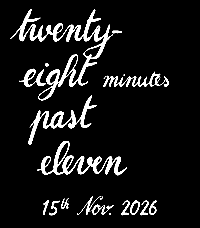

<!-- Generated by scripts/update_app_directory.py: do not edit by hand -->
[← All Pebble Developers](../developers.md)

# Chrono\_Tata

*1 watchface · Last updated 2026-11-16 · [About these lists](../about-app-lists.md)*

Links: [Pebble App Store](https://apps.repebble.com/apps/dev/chrono-tata_3f31eff1f1702087d1cf68e0) · [GitHub (chronotata)](https://github.com/chronotata)

<h2 class="app-name" id="app-e6bd4067de2549e2bdc4d10f"><a href="https://apps.repebble.com/e6bd4067de2549e2bdc4d10f">Handwritten As Spoken</a> v1.3.1</h2>
<a class="app-source" href="https://github.com/chronotata/handwriting-as-spoken-watchface" title="Source code" data-search-exclude>View source</a>

Watchface

Other Released 2026-11-15 Updated 2026-11-15

Runs on: Time 2

Tells the time the way it would traditionally be said out loud: &quot;quarter past three&quot;, &quot;twenty-nine minutes to midnight&quot;, &quot;half past seven&quot;. Every hand-drawn word appears as if it&#x27;s being written…

