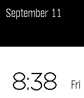
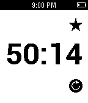

<!-- Generated by scripts/update_app_directory.py: do not edit by hand -->
[← All Pebble Developers](../developers.md)

# chuckwired

*1 watchface and 1 app · Last updated 2026-10-12 · [About these lists](../about-app-lists.md)*

Links: [Pebble App Store](https://apps.repebble.com/apps/dev/chuckwired_5396e9b9eecf9bef32000048) · [GitHub (chuckwired)](https://github.com/chuckwired)

<button type="button" data-filter="all" aria-pressed="true">All 2</button><button type="button" data-filter="watchface" aria-pressed="false">Watchfaces 1</button><button type="button" data-filter="watchapp" aria-pressed="false">Apps 1</button>

<label class="dev-sort">Sort by <select><option value="updated">Recently updated</option><option value="released">Newest release</option><option value="title">A–Z</option></select></label>

<h2 class="app-name" id="app-55f3f4b2f4177df278000075"><a href="https://apps.repebble.com/55f3f4b2f4177df278000075">Todeloj</a> v0.1</h2>
<a class="app-source" href="https://github.com/chuckwired/Todeloj" title="Source code" data-search-exclude>View source</a>

Watchface

GPL-2.0 Released 2015-09-12 Updated 2015-09-12

Runs on: Time 2, Pebble 2 Duo, Pebble 2, Time, Classic

All-in-one clean display of the time, date, day and battery life! Todeloj is a Spanish mix of the word &quot;todo&quot;, meaning all, and &quot;reloj&quot; meaning clock or watch. I am frustrated not being able to…

<h2 class="app-name" id="app-55f3346c1e9927da45000015"><a href="https://apps.repebble.com/55f3346c1e9927da45000015">WWatch</a> v0.3</h2>
<a class="app-source" href="https://github.com/chuckwired/WWatch" title="Source code" data-search-exclude>View source</a>

App

GPL-2.0 Released 2015-09-11 Updated 2015-09-11

Runs on: Time 2, Pebble 2 Duo, Pebble 2, Time, Classic

Essential stopwatch to keep track of your workout session! Start, stop and resume a session and review up to 5 previous sessions. Stopwatch only goes up to 1 hour maximum to encourage you to…

