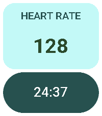

<!-- Generated by scripts/update_app_directory.py: do not edit by hand -->
[← All Pebble Developers](../developers.md)

# ciabattarichri

*1 app · Last updated 2026-11-23 · [About these lists](../about-app-lists.md)*

Links: [Pebble App Store](https://apps.repebble.com/apps/dev/ciabattarichri_f98aaa2484338ade485111c5) · [GitHub (ciabattarichri)](https://github.com/ciabattarichri)

<h2 class="app-name" id="app-13653af0f85f46b1b806f7b4"><a href="https://apps.repebble.com/13653af0f85f46b1b806f7b4">Health Companion</a> v0.3.1</h2>
<a class="app-source" href="https://github.com/ciabattarichri/fitbit_air_pebble_comp" title="Source code" data-search-exclude>View source</a>

App

No licence Released 2026-11-11 Updated 2026-11-11

Runs on: Round 2, Time 2, Pebble 2 Duo, Pebble 2, Time Round, Time, Classic

DESCRIPTION See your live workout on your wrist: heart rate and elapsed time from Google Health, right on your Pebble. Health Companion works with the Google Health app (and Fitbit trackers such…

