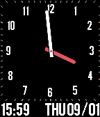

<!-- Generated by scripts/update_app_directory.py: do not edit by hand -->
[← All Pebble Developers](../developers.md)

# cityhawk

*1 watchface · Last updated 2026-10-12 · [About these lists](../about-app-lists.md)*

Links: [Pebble App Store](https://apps.repebble.com/apps/dev/cityhawk_52e93f91ad615baba400005b) · [GitHub (CityHawk)](https://github.com/CityHawk)

<h2 class="app-name" id="app-57c888c45e3c3d1854000758"><a href="https://apps.repebble.com/57c888c45e3c3d1854000758">Simple Hybrid</a> v1.1</h2>
<a class="app-source" href="https://github.com/CityHawk/mywatchface" title="Source code" data-search-exclude>View source</a>

Watchface

No licence Released 2016-09-01 Updated 2016-09-08

Runs on: Time 2, Pebble 2 Duo, Pebble 2, Time, Classic

Simple Hybrid, displaying both analog and digital versions. No tuning, no battery status, no bluetooth disconnect info (though this one pending). This watchface is just how I dreamed about my…

