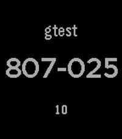
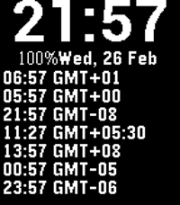
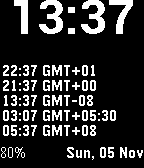
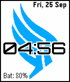
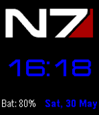
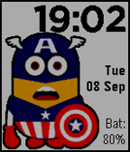

<!-- Generated by scripts/update_app_directory.py: do not edit by hand -->
[← All Pebble Developers](../developers.md)

# clach04

*10 watchfaces and 1 app · Last updated 2026-10-12 · [About these lists](../about-app-lists.md)*

Links: [Rebble App Store](https://apps.rebble.io/en_US/developer/5524604a9de9550a3300007a/1) · [Pebble App Store](https://apps.repebble.com/apps/dev/clach04_5524604a9de9550a3300007a) · [GitHub (clach04)](https://github.com/clach04)

<button type="button" data-filter="all" aria-pressed="true">All 11</button><button type="button" data-filter="watchface" aria-pressed="false">Watchfaces 10</button><button type="button" data-filter="watchapp" aria-pressed="false">Apps 1</button>

<label class="dev-sort">Sort by <select><option value="updated">Recently updated</option><option value="released">Newest release</option><option value="title">A–Z</option></select></label>

<h2 class="app-name" id="app-69a50e6dc698570008fa2fc6"><a href="https://apps.rebble.io/en_US/application/69a50e6dc698570008fa2fc6">otp4p</a> v2.4</h2>
<a class="app-source" href="https://github.com/clach04/pebble-otp4p" title="Source code" data-search-exclude>View source</a>

App

No licence Released 2026-03-02 Updated 2026-03-03 Rebble App Store

Runs on: Round 2, Time 2, Pebble 2 Duo, Pebble 2, Time Round, Time, Classic

Offline config (via Clay) [TOTP](http://en.wikipedia.org/wiki/Time-based_One-time_Password_Algorithm) based two-factor authentication manager for Pebble. It generates **T**ime-based…

<h2 class="app-name" id="app-693defeac098f800098a8394"><a href="https://apps.rebble.io/en_US/application/693defeac098f800098a8394">7 timezones</a> v1.7</h2>
<a class="app-source" href="https://github.com/clach04/pebble_tz/" title="Source code" data-search-exclude>View source</a>

Watchface · <a href="https://forum.rebble.io/t/254" title="Discuss this app on the Rebble forum" data-search-exclude>Forum thread</a>

Apache-2.0 Released 2025-12-13 Updated 2026-03-02 Rebble App Store

Runs on: Round 2, Time 2, Pebble 2 Duo, Pebble 2, Time Round, Time, Classic

Newer version of Minute TZ - with 7 (seven) Time Zones Pebble Watchface For Multiple Timezones * Display time, updating once per minute, using system font * Display Battery power * Display notice…

<h2 class="app-name" id="app-57cdf8c0a789e1e0b800000d"><a href="https://apps.repebble.com/57cdf8c0a789e1e0b800000d">Rota Minute</a> v1.4</h2>
<a class="app-source" href="https://github.com/clach04/watchface_rota_minute/" title="Source code" data-search-exclude>View source</a>

Watchface · <a href="https://forum.rebble.io/t/617" title="Discuss this app on the Rebble forum" data-search-exclude>Forum thread</a>

Apache-2.0 Released 2016-09-05 Updated 2026-02-22

Runs on: Round 2, Time 2, Pebble 2 Duo, Pebble 2, Time Round, Time, Classic

Supports Pebble versions from Pebble 2 (Diorite) to Aplite with quick view support. * Handles Quick Event view * Display time, updating once per minute * 12/14 hour display * Date * Display…

<h2 class="app-name" id="app-59c57619461a8dbd6500037b"><a href="https://apps.rebble.io/en_US/application/59c57619461a8dbd6500037b">Minute TZ</a> v1.3</h2>
<a class="app-source" href="https://github.com/clach04/pebble_tz" title="Source code" data-search-exclude>View source</a>

Watchface

Apache-2.0 Released 2017-09-22 Updated 2017-11-05 Rebble App Store

Runs on: Round 2, Time 2, Pebble 2 Duo, Pebble 2, Time Round, Time, Classic

Pebble Watchface For Multiple Timezones * Display time, updating once per minute, using system font * Display Battery power * Display notice when Bluetooth is disconnected * Have a config/settings…

<h2 class="app-name" id="app-56e3a6325d0b2e83b000003f"><a href="https://apps.repebble.com/56e3a6325d0b2e83b000003f">Colony</a> v0.3</h2>
<a class="app-source" href="https://github.com/clach04/watchface_colony" title="Source code" data-search-exclude>View source</a>

Watchface

Apache-2.0 Released 2016-03-12 Updated 2017-01-08

Runs on: Round 2, Time 2, Pebble 2 Duo, Pebble 2, Time Round, Time, Classic

* Display time, updating once per minute- using system font * Display Battery power * Display notice when Bluetooth is disconnected * Have a config/settings option on Phone to configure: *…

<h2 class="app-name" id="app-56d32355d4f5886aa2000022"><a href="https://apps.repebble.com/56d32355d4f5886aa2000022">Simple Step</a> v0.7</h2>
<a class="app-source" href="https://github.com/clach04/watchface_simple_step" title="Source code" data-search-exclude>View source</a>

Watchface

Apache-2.0 Released 2016-02-28 Updated 2016-11-25

Runs on: Round 2, Time 2, Pebble 2 Duo, Pebble 2, Time Round, Time, Classic

Simple digital watch face with step count. Supports Aplite (original Pebble) by simply hiding the step counter. Offline config/settings Pebble Time and Chalk support color selection. Optional…

<h2 class="app-name" id="app-5606177b1ba070a986000032"><a href="https://apps.repebble.com/5606177b1ba070a986000032">Jupiter Mass Xen</a> v0.7</h2>
<a class="app-source" href="https://github.com/clach04/watchface_JupiterMass/" title="Source code" data-search-exclude>View source</a>

Watchface

GPL-2.0 Released 2015-09-26 Updated 2016-06-18

Runs on: Round 2, Time 2, Pebble 2 Duo, Pebble 2, Time Round, Time, Classic

Basic digital watch face for the Pebble smartwatch. Features: * Updates once per minute * Includes battery status * Supports Aplite (original Pebble), Basalt (Pebble Time), and Chalk (Pebble Time…

<h2 class="app-name" id="app-56590d7bdaf7fffed3000039"><a href="https://apps.repebble.com/56590d7bdaf7fffed3000039">Oregon Owl</a> v0.4</h2>
<a class="app-source" href="https://github.com/clach04/watchface_oregon_owl" title="Source code" data-search-exclude>View source</a>

Watchface

Apache-2.0 Released 2015-11-28 Updated 2015-11-28

Runs on: Round 2, Time 2, Pebble 2 Duo, Pebble 2, Time Round, Time, Classic

Oregon hat snatching owl

<h2 class="app-name" id="app-55d0e5b635a72bac4a000030"><a href="https://apps.repebble.com/55d0e5b635a72bac4a000030">Paragade</a> v0.5</h2>
<a class="app-source" href="https://github.com/clach04/watchface_Paragade/" title="Source code" data-search-exclude>View source</a>

Watchface

GPL-2.0 Released 2015-08-16 Updated 2015-09-26

Runs on: Time 2, Pebble 2 Duo, Pebble 2, Time, Classic

Paragade/Renegon, Paragon or Renegade? Basic digital watch face for the Pebble smartwatch. Features: * Updates once per minute * Includes battery status * Supports Aplite (original Pebble) and…

<h2 class="app-name" id="app-556a4727da4c418e7800006f"><a href="https://apps.repebble.com/556a4727da4c418e7800006f">Jupiter Mass</a> v0.4</h2>
<a class="app-source" href="https://github.com/clach04/watchface_JupiterMass" title="Source code" data-search-exclude>View source</a>

Watchface

GPL-2.0 Released 2015-05-30 Updated 2015-09-26

Runs on: Time 2, Pebble 2 Duo, Pebble 2, Time, Classic

Note see new watchface Jupter Mass Xen, which has a slightly bigger font for time. Simple digital watchface that updates once a minute. For Basalt (Time) and Aplite (Pebble). Includes battery…

<h2 class="app-name" id="app-55ef9806dd0987a7c7000079"><a href="https://apps.repebble.com/55ef9806dd0987a7c7000079">CapNion</a> v0.1</h2>
<a class="app-source" href="https://github.com/clach04/watchface_CapNion/" title="Source code" data-search-exclude>View source</a>

Watchface

GPL-2.0 Released 2015-09-09 Updated 2015-09-09

Runs on: Time 2, Time

Basic digital watch face for the Pebble Time (Basalt only) smartwatch. Features: * Updates once per minute * Includes battery status * Displays when Bluetooth connection is lost and optionally…

