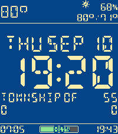

<!-- Generated by scripts/update_app_directory.py: do not edit by hand -->
[← All Pebble Developers](../developers.md)

# clbwhazzup

*1 watchface · Last updated 2026-10-12 · [About these lists](../about-app-lists.md)*

Links: [Pebble App Store](https://apps.repebble.com/apps/dev/clbwhazzup_4dfd3d3f6f2f98c35e1cc0c8) · [GitHub (clbwhazzup)](https://github.com/clbwhazzup) · [Website (clbwhazzup.github.io)](https://clbwhazzup.github.io/)

<h2 class="app-name" id="app-7bd156396b3649bc9612992d"><a href="https://apps.repebble.com/7bd156396b3649bc9612992d">Segmented Info</a> v1.3</h2>
<a class="app-source" href="https://github.com/clbwhazzup/the-pebble-watchface" title="Source code" data-search-exclude>View source</a>

Watchface · <a href="https://forum.rebble.io/t/783" title="Discuss this app on the Rebble forum" data-search-exclude>Forum thread</a>

No licence Released 2026-03-16 Updated 2026-09-10

Runs on: Time 2, Pebble 2 Duo, Pebble 2, Time, Classic

A Very Informative Watchface * Toggle / options for every display element (except time) * Temperature, high/low, humidity, precipitation %, conditions icon, sunrise and sunset times, served from…

