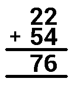

<!-- Generated by scripts/update_app_directory.py: do not edit by hand -->
[← All Pebble Developers](../developers.md)

# Clearer Code

*1 watchface · Last updated 2026-10-12 · [About these lists](../about-app-lists.md)*

Links: [Pebble App Store](https://apps.repebble.com/apps/dev/clearer-code_56824ee7c8a12ad96a0000c1) · [GitHub (krisajenkins)](https://github.com/krisajenkins)

<h2 class="app-name" id="app-568ad41c496916ec9c000072"><a href="https://apps.repebble.com/568ad41c496916ec9c000072">Sums</a> v2.0</h2>
<a class="app-source" href="https://github.com/krisajenkins/sums" title="Source code" data-search-exclude>View source</a>

Watchface

Released 2016-01-04 Updated 2016-01-25

Runs on: Time 2, Pebble 2 Duo, Pebble 2, Time, Classic

A fun watchface in the style of classroom arithmetic. The first line is the hour, the second the minutes, and they&#x27;re added together for fun &amp; nonsense.

