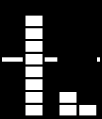

<!-- Generated by scripts/update_app_directory.py: do not edit by hand -->
[← All Pebble Developers](../developers.md)

# ClementG

*2 watchfaces · Last updated 2026-10-11 · [About these lists](../about-app-lists.md)*

Links: [Pebble App Store](https://apps.repebble.com/apps/dev/clementg_52a9594cc0ca93c0b6000031) · [GitHub (clementGdev)](https://github.com/clementGdev)

<button type="button" data-filter="all" aria-pressed="true">All 2</button><button type="button" data-filter="watchface" aria-pressed="false">Watchfaces 2</button><button type="button" data-filter="watchapp" aria-pressed="false" disabled>Apps 0</button>

<label class="dev-sort">Sort by <select><option value="updated">Recently updated</option><option value="released">Newest release</option><option value="title">A–Z</option></select></label>

<h2 class="app-name" id="app-54f4a44b84bffcb1b100005f"><a href="https://apps.repebble.com/54f4a44b84bffcb1b100005f">Circles</a> v3.1</h2>
<a class="app-source" href="https://github.com/clementGdev/circles_pebble_watchface" title="Source code" data-search-exclude>View source</a>

Watchface

Released 2015-03-02 Updated 2015-05-12

Runs on: Time 2, Pebble 2 Duo, Pebble 2, Time, Classic

Very minimalist watchface. Inner circle is hours, outter circle is minutes, with animations ! On the example, it&#x27;s 10:47 and 10:48 Dev is at its earliest stage, more to come on this watchface !…

<h2 class="app-name" id="app-52acf23c19ff50d903000024"><a href="https://apps.repebble.com/52acf23c19ff50d903000024">E8 Watchface</a> v2.6</h2>
<a class="app-source" href="https://github.com/clementGdev/E8_pebble_watchface" title="Source code" data-search-exclude>View source</a>

Watchface

Released 2013-12-15 Updated 2015-04-27

Runs on: Time 2, Pebble 2 Duo, Pebble 2, Time, Classic

Configurable : you can choose black or white, if you want to display the battery life... And squares are now Animated ! This watchface was inspired by the E8 watch from Lexon, originally designed…

