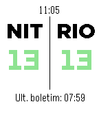

<!-- Generated by scripts/update_app_directory.py: do not edit by hand -->
[← All Pebble Developers](../developers.md)

# Cleyton Slaviero

*1 app · Last updated 2026-10-12 · [About these lists](../about-app-lists.md)*

Links: [Pebble App Store](https://apps.repebble.com/apps/dev/cleyton-slaviero_54b27b5c3b59afc0b2000072)

<h2 class="app-name" id="app-5622c9edbdf1bfbb7000000a"><a href="https://apps.repebble.com/5622c9edbdf1bfbb7000000a">Ponte Rio-Niterói</a> v0.5</h2>
<a class="app-source" href="http://cslaviero.github.io/statusponte/" title="Source code" data-search-exclude>View source</a>

App

Released 2015-10-17 Updated 2016-04-08

Runs on: Round 2, Time 2, Pebble 2 Duo, Pebble 2, Time Round, Time, Classic

Watchapp para saber o tempo de travessia da Ponte Rio-Niterói (RJ - Brasil). --- Watchapp to discover the journey time to cross the Rio-Niterói Bridge. (RJ - Brazil).

