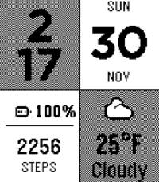

<!-- Generated by scripts/update_app_directory.py: do not edit by hand -->
[← All Pebble Developers](../developers.md)

# Click\_Calick\_Click

*2 watchfaces · Last updated 2026-10-12 · [About these lists](../about-app-lists.md)*

Links: [Pebble App Store](https://apps.repebble.com/apps/dev/click-calick-click_5c6cdab636abd90001909eef) · [GitHub (ClickCalickClick)](https://github.com/ClickCalickClick)

<button type="button" data-filter="all" aria-pressed="true">All 2</button><button type="button" data-filter="watchface" aria-pressed="false">Watchfaces 2</button><button type="button" data-filter="watchapp" aria-pressed="false" disabled>Apps 0</button>

<label class="dev-sort">Sort by <select><option value="updated">Recently updated</option><option value="released">Newest release</option><option value="title">A–Z</option></select></label>

<h2 class="app-name" id="app-692cac43ef41e0000886ac3a"><a href="https://apps.repebble.com/692cac43ef41e0000886ac3a">Modules</a> v1.0</h2>
<a class="app-source" href="https://github.com/ClickCalickClick/modules-watchface" title="Source code" data-search-exclude>View source</a>

Watchface

No licence Released 2025-11-30 Updated 2025-11-30

Runs on: Time 2, Pebble 2 Duo, Pebble 2, Time, Classic

Modules is a feature-rich watchface designed for Pebble smartwatches that puts you in control. Unlike traditional watchfaces that lock you into a fixed layout, Modules breaks down your display…

<h2 class="app-name" id="app-690a5829736c520009381b8e"><a href="https://apps.repebble.com/690a5829736c520009381b8e">Word of the Lord</a> v1.0</h2>
<a class="app-source" href="https://github.com/ClickCalickClick/word-of-the-lord" title="Source code" data-search-exclude>View source</a>

Watchface

No licence Released 2025-11-04 Updated 2025-11-04

Runs on: Time 2, Pebble 2 Duo, Pebble 2, Time, Classic

A comprehensive Christian Daily Gospel watchface for Pebble smartwatches that displays the time, date, weather, and daily scripture readings. Stay connected to your faith throughout the day with…

