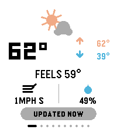
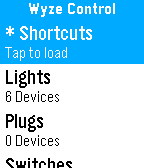
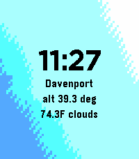
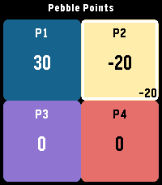

<!-- Generated by scripts/update_app_directory.py: do not edit by hand -->
[← All Pebble Developers](../developers.md)

# ClickCalickClick (Touchy Weather)

*1 watchface and 3 apps · Last updated 2026-10-12 · [About these lists](../about-app-lists.md)*

Links: [Pebble App Store](https://apps.repebble.com/apps/dev/clickcalickclick-touchy-weather_703379b8b79fb665a4666945) · [GitHub (ClickCalickClick)](https://github.com/ClickCalickClick)

<button type="button" data-filter="all" aria-pressed="true">All 4</button><button type="button" data-filter="watchface" aria-pressed="false">Watchfaces 1</button><button type="button" data-filter="watchapp" aria-pressed="false">Apps 3</button>

<label class="dev-sort">Sort by <select><option value="updated">Recently updated</option><option value="released">Newest release</option><option value="title">A–Z</option></select></label>

<h2 class="app-name" id="app-532286232c5d4dc499b5918c"><a href="https://apps.repebble.com/532286232c5d4dc499b5918c">Touchy Weather - Weather App</a> v2.3.1</h2>
<a class="app-source" href="https://github.com/ClickCalickClick/TouchyWeather" title="Source code" data-search-exclude>View source</a>

App

Other Released 2026-05-14 Updated 2026-09-03

Runs on: Round 2, Time 2, Pebble 2 Duo, Pebble 2, Time Round, Time

TouchyWeather is a playful, card-based weather app for Pebble that mixes useful forecast data with personality for touchscreen Pebble Watches. It’s designed around fast swipes, quick glances, and…

<h2 class="app-name" id="app-05b16db5ea9949bbbabe972f"><a href="https://apps.repebble.com/05b16db5ea9949bbbabe972f">Wyze Control</a> v1.3</h2>
<a class="app-source" href="https://github.com/ClickCalickClick/Wyze-Control-for-Pebble" title="Source code" data-search-exclude>View source</a>

App

No licence Released 2026-04-18 Updated 2026-06-17

Runs on: Round 2, Time 2, Pebble 2 Duo, Pebble 2, Time Round, Time, Classic

# Wyze Control for Pebble - Application Description ## A complete Wyze control center, built for Pebble **Wyze Control for Pebble** turns your smartwatch into a practical control surface for your…

<h2 class="app-name" id="app-6a181c317d2b4f438dc28bea"><a href="https://apps.repebble.com/6a181c317d2b4f438dc28bea">Aura</a> v2.6</h2>
<a class="app-source" href="https://github.com/ClickCalickClick/Sky_C" title="Source code" data-search-exclude>View source</a>

Watchface

No licence Released 2026-04-12 Updated 2026-05-21

Runs on: Round 2, Time 2, Time Round, Time

Aura: The Sky, Hand-Painted by Physics Why settle for a static watchface when you can wear the actual atmosphere? Aura is a real-time, mathematically driven simulation of the light above your…

<h2 class="app-name" id="app-63515ba580094bc4af7cf70c"><a href="https://apps.repebble.com/63515ba580094bc4af7cf70c">Pebble Points</a> v1.6</h2>
<a class="app-source" href="https://github.com/ClickCalickClick/Pebble-Points" title="Source code" data-search-exclude>View source</a>

App

No licence Released 2026-04-07 Updated 2026-04-10

Runs on: Round 2, Time 2, Pebble 2 Duo, Pebble 2, Time Round, Time, Classic

Pebble Points is a fast, colorful multiplayer score tracker for Pebble watches. Keep score for 2 to 4 players with a layout that adapts to the watch face, clear high-contrast visuals, and simple…

