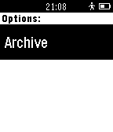

<!-- Generated by scripts/update_app_directory.py: do not edit by hand -->
[← All Pebble Developers](../developers.md)

# clintoncrick

*1 app · Last updated 2026-10-12 · [About these lists](../about-app-lists.md)*

Links: [Pebble App Store](https://apps.repebble.com/apps/dev/clintoncrick_54cfb2330dcf4512f9000099) · [GitHub (clintoncrick)](https://github.com/clintoncrick)

<h2 class="app-name" id="app-54d96e9e63eb4186fc000048"><a href="https://apps.repebble.com/54d96e9e63eb4186fc000048">Unofficial Support for Trello</a> v1.4</h2>
<a class="app-source" href="https://github.com/clintoncrick/Unofficial-Support-for-Trello" title="Source code" data-search-exclude>View source</a>

App

No licence Released 2015-02-10 Updated 2015-12-18

Runs on: Time 2, Pebble 2 Duo, Pebble 2, Time, Classic

&quot;Unofficial Support for Trello&quot; is a Pebble app which allows access to your Trello boards. View boards, lists, and individual cards from your Pebble. Change log: *Version 1.4 (2015-12-17) fixes…

