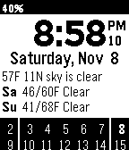

<!-- Generated by scripts/update_app_directory.py: do not edit by hand -->
[← All Pebble Developers](../developers.md)

# ClintonK

*1 watchface · Last updated 2026-10-12 · [About these lists](../about-app-lists.md)*

Links: [Pebble App Store](https://apps.repebble.com/apps/dev/clintonk_5430520ca2f62248d600017b) · [GitHub (clintka)](https://github.com/clintka) · [Website (forums.getpebble.com)](http://forums.getpebble.com/discussion/17838/watch-face-all-info-as-text)

<h2 class="app-name" id="app-5468b9fe32e2d7bfbc0000ce"><a href="https://apps.repebble.com/5468b9fe32e2d7bfbc0000ce">All Info As Text</a> v1.2</h2>
<a class="app-source" href="https://github.com/clintka/AllInfoAsText.git" title="Source code" data-search-exclude>View source</a>

Watchface

Unlicense Released 2014-11-16 Updated 2015-10-26

Runs on: Time 2, Pebble 2 Duo, Pebble 2, Time, Classic

All Info As Text watch face delivers the time, date, current weather, today&#x27;s / tomorrow&#x27;s forecast, and a 2 week calendar. Config options include: week format temperature units wind speed units…

