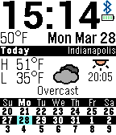

<!-- Generated by scripts/update_app_directory.py: do not edit by hand -->
[← All Pebble Developers](../developers.md)

# clreinki

*1 watchface · Last updated 2026-10-11 · [About these lists](../about-app-lists.md)*

Links: [Pebble App Store](https://apps.repebble.com/apps/dev/clreinki_5572c8837d6f3db94c00001a) · [GitHub (clreinki)](https://github.com/clreinki)

<h2 class="app-name" id="app-56f97f933f944df121000009"><a href="https://apps.repebble.com/56f97f933f944df121000009">Wunder ForeCal</a> v1.03</h2>
<a class="app-source" href="https://github.com/clreinki/forecal" title="Source code" data-search-exclude>View source</a>

Watchface

Released 2016-03-28 Updated 2016-04-03

Runs on: Round 2, Time 2, Pebble 2 Duo, Pebble 2, Time Round, Time, Classic

This watchface is a forked version of ForeCal by SeaPea Software - instead of using Yahoo Weather, this version uses the Wunderground API! Note that FREE registration with Wunderground.com is…

