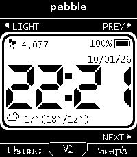
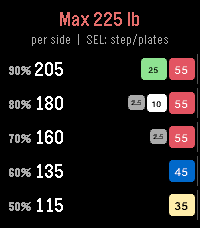

<!-- Generated by scripts/update_app_directory.py: do not edit by hand -->
[← All Pebble Developers](../developers.md)

# cmalec

*1 watchface and 1 app · Last updated 2026-10-11 · [About these lists](../about-app-lists.md)*

Links: [Rebble App Store](https://apps.rebble.io/en_US/developer/6aaf0376ed67e90009f5a8d9/1) · [GitHub (cmalec)](https://github.com/cmalec)

<button type="button" data-filter="all" aria-pressed="true">All 2</button><button type="button" data-filter="watchface" aria-pressed="false">Watchfaces 1</button><button type="button" data-filter="watchapp" aria-pressed="false">Apps 1</button>

<label class="dev-sort">Sort by <select><option value="updated">Recently updated</option><option value="released">Newest release</option><option value="title">A–Z</option></select></label>

<h2 class="app-name" id="app-6abf42344412b30009377a5f"><a href="https://apps.rebble.io/en_US/application/6abf42344412b30009377a5f">Segment</a> v1.0.0</h2>
<a class="app-source" href="https://github.com/cmalec/segment-watchface" title="Source code" data-search-exclude>View source</a>

Watchface · <a href="https://forum.rebble.io/t/1397" title="Discuss this app on the Rebble forum" data-search-exclude>Forum thread</a>

Released 2026-10-02 Updated 2026-10-02 Rebble App Store

Runs on: Time 2

Segment is a seven-segment digital watchface for the Pebble Time 2, in the spirit of the classic 91 Dub. The clock is a large seven-segment readout with an optional seconds row. The row above it…

<h2 class="app-name" id="app-6aaf0625cf733a0009498c27"><a href="https://apps.rebble.io/en_US/application/6aaf0625cf733a0009498c27">pl8s</a> v1.0.1</h2>
<a class="app-source" href="https://github.com/cmalec/pl8s" title="Source code" data-search-exclude>View source</a>

App · <a href="https://forum.rebble.io/t/1371" title="Discuss this app on the Rebble forum" data-search-exclude>Forum thread</a>

Released 2026-09-19 Updated 2026-09-20 Rebble App Store

Runs on: Round 2, Time 2, Pebble 2 Duo, Pebble 2, Time Round, Time, Classic

pl8s (&quot;plates&quot;) is a barbell percentage and plate calculator for your wrist. Enter a training max once and it shows each working weight with the exact plates to load per side, so the math is done…

