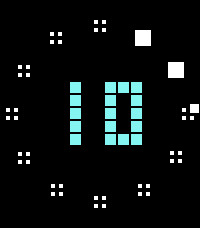

<!-- Generated by scripts/update_app_directory.py: do not edit by hand -->
[← All Pebble Developers](../developers.md)

# cmore consulting

*1 watchface · Last updated 2026-10-12 · [About these lists](../about-app-lists.md)*

Links: [Rebble App Store](https://apps.rebble.io/en_US/developer/69000edb69551c0008c10800/1) · [GitHub (cmore-zz)](https://github.com/cmore-zz)

<h2 class="app-name" id="app-6a432c036b3a67000985d355"><a href="https://apps.rebble.io/en_US/application/6a432c036b3a67000985d355">Minute Blocks</a> v1.1.0</h2>
<a class="app-source" href="https://github.com/cmore-zz/pebble-minute-blocks" title="Source code" data-search-exclude>View source</a>

Watchface · <a href="https://forum.rebble.io/t/1106" title="Discuss this app on the Rebble forum" data-search-exclude>Forum thread</a>

No licence Released 2026-06-30 Updated 2026-07-01 Rebble App Store

Runs on: Round 2, Time 2, Pebble 2 Duo, Pebble 2, Time Round, Time, Classic

A blocky digital watchface with minute-by-minute geometry, pixel text, and configurable corner &quot;complications&quot; on rectangular Pebble watches, and centered complications on round Pebble watches…

