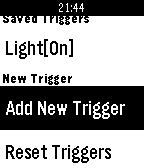
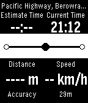

<!-- Generated by scripts/update_app_directory.py: do not edit by hand -->
[← All Pebble Developers](../developers.md)

# CMWen

*2 apps · Last updated 2026-10-11 · [About these lists](../about-app-lists.md)*

Links: [Pebble App Store](https://apps.repebble.com/apps/dev/cmwen_5553ace1dd51ad193d000060) · [GitHub (cmwen)](https://github.com/cmwen)

<button type="button" data-filter="all" aria-pressed="true">All 2</button><button type="button" data-filter="watchface" aria-pressed="false" disabled>Watchfaces 0</button><button type="button" data-filter="watchapp" aria-pressed="false">Apps 2</button>

<label class="dev-sort">Sort by <select><option value="updated">Recently updated</option><option value="released">Newest release</option><option value="title">A–Z</option></select></label>

<h2 class="app-name" id="app-56b47e6a02a659ea2e00000e"><a href="https://apps.repebble.com/56b47e6a02a659ea2e00000e">IFLocation</a> v1.7</h2>
<a class="app-source" href="http://cmwen.github.io/iflocation/" title="Source code" data-search-exclude>View source</a>

App

Released 2016-02-05 Updated 2016-04-21

Runs on: Time 2, Pebble 2 Duo, Pebble 2, Time, Classic

IFLocation is an watch app allows you to send IFTTT Maker event on your waist. You need to connect your Maker channel, get the Maker key, then open the settings of this app on your phone…

<h2 class="app-name" id="app-56cd86c686ce3bde59000019"><a href="https://apps.repebble.com/56cd86c686ce3bde59000019">CanIMakeIt</a> v1.2</h2>
<a class="app-source" href="https://github.com/cmwen/CanIMakeIt" title="Source code" data-search-exclude>View source</a>

App

Released 2016-02-24 Updated 2016-02-26

Runs on: Time 2, Pebble 2 Duo, Pebble 2, Time, Classic

Wondering when you will get to the station everything when you rush out your home? This is a tool for you. CanIMakeIt shows you the distance to your destination and base on your current to…

