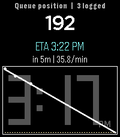

<!-- Generated by scripts/update_app_directory.py: do not edit by hand -->
[← All Pebble Developers](../developers.md)

# Cobalt Mainspring

*2 apps · Last updated 2026-11-02 · [About these lists](../about-app-lists.md)*

Links: [Pebble App Store](https://apps.repebble.com/apps/dev/cobalt-mainspring_188295d081cb82fac15db0c4) · [GitHub (WhenInWome)](https://github.com/WhenInWome)

<button type="button" data-filter="all" aria-pressed="true">All 2</button><button type="button" data-filter="watchface" aria-pressed="false" disabled>Watchfaces 0</button><button type="button" data-filter="watchapp" aria-pressed="false">Apps 2</button>

<label class="dev-sort">Sort by <select><option value="updated">Recently updated</option><option value="released">Newest release</option><option value="title">A–Z</option></select></label>

<h2 class="app-name" id="app-01f5a438abbb40c0ad5d8cb5"><a href="https://apps.repebble.com/01f5a438abbb40c0ad5d8cb5">SlapTimer</a> v1.0.1</h2>
<a class="app-source" href="https://github.com/WhenInWome/SlapTimer" title="Source code" data-search-exclude>View source</a>

App

No licence Released 2026-10-30 Updated 2026-10-30

Runs on: Time 2

Vibe coded timer app, set the time (5s intervals), tap the screen to count down, it vibrates, tap again to restart. Remembers timing between opens. I use it for timing rest between gym sets…

<h2 class="app-name" id="app-93402f8563884f00ad4bfd5e"><a href="https://apps.repebble.com/93402f8563884f00ad4bfd5e">QueueETA</a> v1.0.1</h2>
<a class="app-source" href="https://github.com/WhenInWome/QueueTimer" title="Source code" data-search-exclude>View source</a>

App

No licence Released 2026-10-30 Updated 2026-10-30

Runs on: Round 2, Time 2, Pebble 2 Duo, Pebble 2, Time Round, Time, Classic

Vibe coded app to estimate when you&#x27;ll reach the front of a queue. Enter your initial position, and then after some time (can be anything, but I recommend at least 30 seconds) tap your position…

