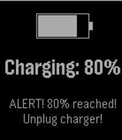

<!-- Generated by scripts/update_app_directory.py: do not edit by hand -->
[← All Pebble Developers](../developers.md)

# Coconauts

*1 watchface and 1 app · Last updated 2026-10-11 · [About these lists](../about-app-lists.md)*

Links: [Pebble App Store](https://apps.repebble.com/apps/dev/coconauts_1e79b46fb4a32ceee9259940) · [GitHub (coconauts)](https://github.com/coconauts) · [GitHub (rephus)](https://github.com/rephus)

<button type="button" data-filter="all" aria-pressed="true">All 2</button><button type="button" data-filter="watchface" aria-pressed="false">Watchfaces 1</button><button type="button" data-filter="watchapp" aria-pressed="false">Apps 1</button>

<label class="dev-sort">Sort by <select><option value="updated">Recently updated</option><option value="released">Newest release</option><option value="title">A–Z</option></select></label>

<h2 class="app-name" id="app-4c25df439af543d19c98630a"><a href="https://apps.repebble.com/4c25df439af543d19c98630a">Neko Wristmate</a> v1.1</h2>
<a class="app-source" href="https://github.com/coconauts/pebble-neko-watchface" title="Source code" data-search-exclude>View source</a>

Watchface

Released 2026-04-17 Updated 2026-04-17

Runs on: Round 2, Time 2, Pebble 2 Duo

Neko, the iconic screenmate mascot from the 90s, now in your wrist! An animated neko will play around in your watch. After a while, it will grow tired and go to sleep. It will wake up with a tap.

<h2 class="app-name" id="app-e7540c9775d545af81ba7f3f"><a href="https://apps.repebble.com/e7540c9775d545af81ba7f3f">80% battery charged</a> v1.0</h2>
<a class="app-source" href="https://github.com/rephus/pebble-battery-charged" title="Source code" data-search-exclude>View source</a>

App

Released 2026-04-17 Updated 2026-04-17

Runs on: Round 2, Time 2, Pebble 2 Duo, Pebble 2, Time Round, Time, Classic

Get notified when you charge your pebble and the battery level reaches 80%. This way, you can manually interrupt the charge. Preventing batteries to charge completely has been proven to improve…

