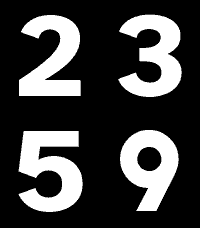

<!-- Generated by scripts/update_app_directory.py: do not edit by hand -->
[← All Pebble Developers](../developers.md)

# codedbydan

*1 watchface · Last updated 2026-10-11 · [About these lists](../about-app-lists.md)*

Links: [Rebble App Store](https://apps.rebble.io/en_US/developer/675dcdbea89c5300085e5402/1) · [GitHub (dan-hart)](https://github.com/dan-hart) · [Website (codedbydan.com)](https://codedbydan.com)

<h2 class="app-name" id="app-690677d87902190009387f04"><a href="https://apps.rebble.io/en_US/application/690677d87902190009387f04">Super Legible</a> v1.1</h2>
<a class="app-source" href="https://github.com/dan-hart/pebble-superlegible-watchface" title="Source code" data-search-exclude>View source</a>

Watchface

Released 2025-11-01 Updated 2025-11-01 Rebble App Store

Runs on: Round 2, Time 2, Pebble 2 Duo, Pebble 2, Time Round, Time, Classic

Super Legible - Maximum Readability for Your Pebble Experience unmatched legibility with a watch face designed for everyone. Super Legible features the Atkinson Hyperlegible font, created by the…

