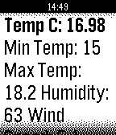

<!-- Generated by scripts/update_app_directory.py: do not edit by hand -->
[← All Pebble Developers](../developers.md)

# CodeLuca

*1 app · Last updated 2026-10-12 · [About these lists](../about-app-lists.md)*

Links: [Pebble App Store](https://apps.repebble.com/apps/dev/codeluca_541dfac98de571fd50000293) · [GitHub (codeluca)](https://github.com/codeluca)

<h2 class="app-name" id="app-541edbe104629f7ba7000025"><a href="https://apps.repebble.com/541edbe104629f7ba7000025">WeatherRequest</a> v1.0</h2>
<a class="app-source" href="http://www.github.com/codeluca/weatherrequest/" title="Source code" data-search-exclude>View source</a>

App

No licence Released 2014-09-21 Updated 2014-09-21

Runs on: Time 2, Pebble 2 Duo, Pebble 2, Time, Classic

Weather Request is a detailed weather app which shows you more than just the temperature.

