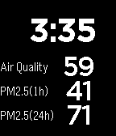

<!-- Generated by scripts/update_app_directory.py: do not edit by hand -->
[← All Pebble Developers](../developers.md)

# Codemonkey

*1 watchface · Last updated 2026-10-11 · [About these lists](../about-app-lists.md)*

Links: [Pebble App Store](https://apps.repebble.com/apps/dev/codemonkey_53145f75ce084fb31a000166) · [GitHub (maverick2000)](https://github.com/maverick2000)

<h2 class="app-name" id="app-539d4f4d126758204b000124"><a href="https://apps.repebble.com/539d4f4d126758204b000124">Shanghai China Pollution PM2.5 Air Quality Index</a> v1.0.0</h2>
<a class="app-source" href="https://github.com/maverick2000/shanghai_pollution_pebble_watchface" title="Source code" data-search-exclude>View source</a>

Watchface

Released 2014-06-15 Updated 2014-06-15

Runs on: Time 2, Pebble 2 Duo, Pebble 2, Time, Classic

Displays the current Air Quality Index, PM2.5 hourly and 24 hour concentrations along with the current time.

