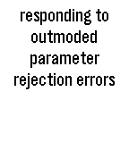

<!-- Generated by scripts/update_app_directory.py: do not edit by hand -->
[← All Pebble Developers](../developers.md)

# codesplice

*1 watchface · Last updated 2026-10-12 · [About these lists](../about-app-lists.md)*

Links: [Pebble App Store](https://apps.repebble.com/apps/dev/codesplice_52f062be3be620c78000173f) · [GitHub (codesplice)](https://github.com/codesplice) · [Website (plus.google.com)](http://plus.google.com/+JohnBowdre)

<h2 class="app-name" id="app-53972b8efd9b27e4be0000d3"><a href="https://apps.repebble.com/53972b8efd9b27e4be0000d3">TeXcuse</a> v0.3.5</h2>
<a class="app-source" href="https://github.com/codesplice/TeXcuse" title="Source code" data-search-exclude>View source</a>

Watchface

No licence Released 2014-06-10 Updated 2014-06-17

Runs on: Time 2, Pebble 2 Duo, Pebble 2, Time, Classic

The standard Big Time watchface, with a secret ability. Flick your wrist to display a randomly-generated excuse overflowing with technobabble. Perfect for meetings when you need to explain that…

