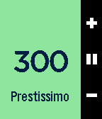

<!-- Generated by scripts/update_app_directory.py: do not edit by hand -->
[← All Pebble Developers](../developers.md)

# Cody

*1 app · Last updated 2026-10-12 · [About these lists](../about-app-lists.md)*

Links: [Pebble App Store](https://apps.repebble.com/apps/dev/cody_567dcf4007ac23d0180003a8) · [GitHub (burn123)](https://github.com/burn123)

<h2 class="app-name" id="app-57a3d37b1482cd5d4b00089d"><a href="https://apps.repebble.com/57a3d37b1482cd5d4b00089d">Visual Metronome</a> v1.4</h2>
<a class="app-source" href="https://github.com/burn123/PebbleMetronome" title="Source code" data-search-exclude>View source</a>

App

MIT Released 2016-08-04 Updated 2017-02-07

Runs on: Round 2, Time 2, Pebble 2 Duo, Pebble 2, Time Round, Time, Classic

This fantastic metronome allows for simple haptic feedback while you play, removing the need to hear anything. It can now model an older metronome by showing a moving metronome arm (shown by…

