<!-- Generated by scripts/update_app_directory.py: do not edit by hand -->
[← All Pebble Developers](../developers.md)

# Comfortably Numb

*37 watchfaces and 5 apps · Last updated 2026-10-11 · [About these lists](../about-app-lists.md)*

Links: [Pebble App Store](https://apps.repebble.com/apps/dev/comfortably-numb_52f547605101128b2200005a) · [GitHub (ygalanter)](https://github.com/ygalanter)

<button type="button" data-filter="all" aria-pressed="true">All 42</button><button type="button" data-filter="watchface" aria-pressed="false">Watchfaces 37</button><button type="button" data-filter="watchapp" aria-pressed="false">Apps 5</button>

<label class="dev-sort">Sort by <select><option value="updated">Recently updated</option><option value="released">Newest release</option><option value="title">A–Z</option></select></label>

<a class="app-shot" href="https://apps.repebble.com/552b12499c306b05a000008e" data-search-exclude>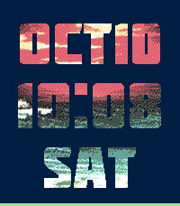</a>

<h2 class="app-name" id="app-552b12499c306b05a000008e"><a href="https://apps.repebble.com/552b12499c306b05a000008e">Simple Striped</a> v3.0.0</h2>
<a class="app-source" href="https://github.com/ygalanter/SimpleStriped" title="Source code" data-search-exclude>View source</a>

Watchface · <a href="https://forum.rebble.io/t/1419" title="Discuss this app on the Rebble forum" data-search-exclude>Forum thread</a>

Released 2015-04-13 Updated 2026-10-10

Runs on: Round 2, Time 2, Pebble 2 Duo, Pebble 2, Time Round, Time, Classic

- Simple watchface showing date and time in big font in striped pattern. - Thin line at the bottom is a battery indicator, length equal remaining charge - Stripe pattern is configurable via options

<a class="app-shot" href="https://apps.repebble.com/57719ccc6c2104ad170001c8" data-search-exclude>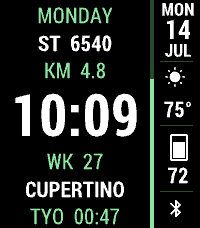</a>

<h2 class="app-name" id="app-57719ccc6c2104ad170001c8"><a href="https://apps.repebble.com/57719ccc6c2104ad170001c8">CobbleStyle 2</a> v1.53.0</h2>
<a class="app-source" href="https://github.com/ygalanter/priv-cobblestyle-2" title="Source code" data-search-exclude>View source</a>

Watchface · <a href="https://forum.rebble.io/t/1115" title="Discuss this app on the Rebble forum" data-search-exclude>Forum thread</a>

Released 2016-06-27 Updated 2026-10-10

Runs on: Round 2, Time 2, Pebble 2 Duo, Pebble 2, Time Round, Time, Classic

Design and Art Direction by Paul Joel - www.pauljoel.com CobbleStyle is back! This time with THREE modes to display the time: analog, digital or BIG TIME! With complete customization on what…

<h2 class="app-name" id="app-a3b06903fd6f46f5b9b8780b"><a href="https://apps.repebble.com/a3b06903fd6f46f5b9b8780b">Letterfall</a> v1.4.0</h2>
<a class="app-source" href="https://github.com/ygalanter/letterfall-pebble" title="Source code" data-search-exclude>View source</a>

App · <a href="https://forum.rebble.io/t/942" title="Discuss this app on the Rebble forum" data-search-exclude>Forum thread</a>

Released 2026-05-02 Updated 2026-10-09

Runs on: Time 2

TEST YOUR BOOKWORM SKILLS! 📝 &quot;Letterfall&quot; is a word-building game. The longer word you make the more scoring points you get. As you add points - you advance in ranks. ⛓️ To create a word - tap…

<a class="app-shot" href="https://apps.repebble.com/53a9f0fa6b1a978507000083" data-search-exclude>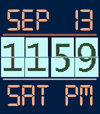</a>

<h2 class="app-name" id="app-53a9f0fa6b1a978507000083"><a href="https://apps.repebble.com/53a9f0fa6b1a978507000083">Big Flip Clock</a> v3.0.0</h2>
<a class="app-source" href="https://github.com/ygalanter/BIG_FLIP_CLOCK" title="Source code" data-search-exclude>View source</a>

Watchface · <a href="https://forum.rebble.io/t/1358" title="Discuss this app on the Rebble forum" data-search-exclude>Forum thread</a>

Released 2014-06-24 Updated 2026-09-13

Runs on: Round 2, Time 2, Pebble 2 Duo, Pebble 2, Time Round, Time, Classic

Old-style flip clock watchface with smooth flip animation, digital date, and day of the week. Supports both 12-hour and 24-hour modes based on the watch setting, including an AM/PM indicator in…

<a class="app-shot" href="https://apps.repebble.com/56e04296320b573560000009" data-search-exclude>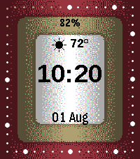</a>

<h2 class="app-name" id="app-56e04296320b573560000009"><a href="https://apps.repebble.com/56e04296320b573560000009">Future Time</a> v2.0.0</h2>
<a class="app-source" href="https://github.com/ygalanter/priv-future-time" title="Source code" data-search-exclude>View source</a>

Watchface · <a href="https://forum.rebble.io/t/1204" title="Discuss this app on the Rebble forum" data-search-exclude>Forum thread</a>

Released 2016-03-09 Updated 2026-08-01

Runs on: Round 2, Time 2, Pebble 2 Duo, Pebble 2, Time Round, Time, Classic

This is the face of the future. Two faces actually - because you get both analog and digital face - and it&#x27;s up to you which one to use. You also get eight predefined color themes as well as…

<a class="app-shot" href="https://apps.repebble.com/ed86adf6e0844037820656ac" data-search-exclude>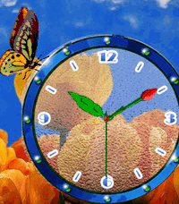</a>

<h2 class="app-name" id="app-ed86adf6e0844037820656ac"><a href="https://apps.repebble.com/ed86adf6e0844037820656ac">Tulip Butterfly</a> v1.0.0</h2>
<a class="app-source" href="https://github.com/ygalanter/tulip-butterfly-pebble" title="Source code" data-search-exclude>View source</a>

Watchface · <a href="https://forum.rebble.io/t/1184" title="Discuss this app on the Rebble forum" data-search-exclude>Forum thread</a>

Released 2026-07-24 Updated 2026-07-24

Runs on: Round 2, Time 2, Time Round, Time

Tulip Butterfly brings a peaceful field of tulips to your wrist, with a beautiful butterfly that gently flaps its wings over a colorful analog clock. Shake your watch to cycle through the date…

<a class="app-shot" href="https://apps.repebble.com/5616de1d7bc7a6ef0a000026" data-search-exclude>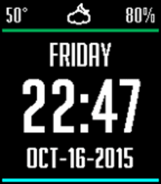</a>

<h2 class="app-name" id="app-5616de1d7bc7a6ef0a000026"><a href="https://apps.repebble.com/5616de1d7bc7a6ef0a000026">Clean &amp; Smart</a> v2.53.0</h2>
<a class="app-source" href="https://github.com/ygalanter/Clean_and_Smart" title="Source code" data-search-exclude>View source</a>

Watchface · <a href="https://forum.rebble.io/t/957" title="Discuss this app on the Rebble forum" data-search-exclude>Forum thread</a>

Released 2015-10-08 Updated 2026-07-19

Runs on: Round 2, Time 2, Pebble 2 Duo, Pebble 2, Time Round, Time, Classic

Design and Art Direction by Paul Joel - www.pauljoel.com Contributions by Yaron Sheffer. Simple and clean watchface featuring large date and time as well as current temperature and weather…

<a class="app-shot" href="https://apps.repebble.com/54dd1bedadaf1dffbb000015" data-search-exclude>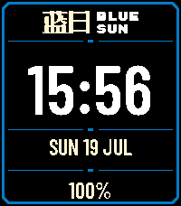</a>

<h2 class="app-name" id="app-54dd1bedadaf1dffbb000015"><a href="https://apps.repebble.com/54dd1bedadaf1dffbb000015">Blue Sun Quotes</a> v2.0.0</h2>
<a class="app-source" href="https://github.com/ygalanter/BLUE_SUN_QUOTES" title="Source code" data-search-exclude>View source</a>

Watchface · <a href="https://forum.rebble.io/t/1166" title="Discuss this app on the Rebble forum" data-search-exclude>Forum thread</a>

Released 2015-02-12 Updated 2026-07-19

Runs on: Round 2, Time 2, Pebble 2 Duo, Pebble 2, Time Round, Time, Classic

BLUE SUN CORTEX TERMINAL A Firefly-inspired Cortex watchface with 471 quotes, battery status, and native layouts. Bring a little piece of the &#x27;Verse to your wrist with Blue Sun Cortex Terminal, a…

<h2 class="app-name" id="app-68a245345ffb456d8ec591ea"><a href="https://apps.repebble.com/68a245345ffb456d8ec591ea">Fields of Gold</a> v1.3.0</h2>
<a class="app-source" href="https://github.com/ygalanter/fields-of-gold-pebble" title="Source code" data-search-exclude>View source</a>

Watchface · <a href="https://forum.rebble.io/t/1161" title="Discuss this app on the Rebble forum" data-search-exclude>Forum thread</a>

Released 2026-07-17 Updated 2026-07-18

Runs on: Round 2, Time 2, Time Round, Time

Digital clock with supersized digit size and image background. You can choose one out of six pre-selected images or select your own image Image opacity is also controlled so you can set how it is…

<a class="app-shot" href="https://apps.repebble.com/688f5e77d36b550009ece4cf" data-search-exclude>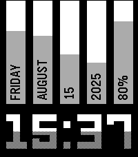</a>

<h2 class="app-name" id="app-688f5e77d36b550009ece4cf"><a href="https://apps.repebble.com/688f5e77d36b550009ece4cf">Vertical Health</a> v2.1.0</h2>
<a class="app-source" href="https://github.com/ygalanter/Vertical-Pebble" title="Source code" data-search-exclude>View source</a>

Watchface · <a href="https://forum.rebble.io/t/1053" title="Discuss this app on the Rebble forum" data-search-exclude>Forum thread</a>

Released 2025-08-03 Updated 2026-07-16

Runs on: Time 2, Pebble 2 Duo, Pebble 2, Time, Classic

Unique watchface design, showing - day of the week - month - date - year - battery percentage in vertical columns, plus time in large digits. Progress bars show time advancements, and battery…

<a class="app-shot" href="https://apps.repebble.com/026ceb1f4d9b4e60bc5acad2" data-search-exclude>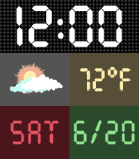</a>

<h2 class="app-name" id="app-026ceb1f4d9b4e60bc5acad2"><a href="https://apps.repebble.com/026ceb1f4d9b4e60bc5acad2">Station Clock</a> v1.6.0</h2>
<a class="app-source" href="https://github.com/ygalanter/Station-Clock-pebble" title="Source code" data-search-exclude>View source</a>

Watchface · <a href="https://forum.rebble.io/t/902" title="Discuss this app on the Rebble forum" data-search-exclude>Forum thread</a>

Released 2026-04-20 Updated 2026-07-16

Runs on: Time 2, Pebble 2 Duo, Pebble 2, Time, Classic

Station Clock is a digital retro-style clock face featuring: Large time 🕒 Date 📅 Weather conditions ⛅ Temperature 🌡️ (Celsius or Fahrenheit, depending on your preferences) Shake the watch to show…

<a class="app-shot" href="https://apps.repebble.com/548911f55db45ef203000053" data-search-exclude>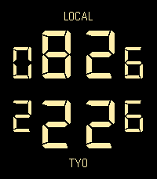</a>

<h2 class="app-name" id="app-548911f55db45ef203000053"><a href="https://apps.repebble.com/548911f55db45ef203000053">Poochie</a> v3.0.0</h2>
<a class="app-source" href="https://github.com/ygalanter/POOCHIE" title="Source code" data-search-exclude>View source</a>

Watchface · <a href="https://forum.rebble.io/t/1157" title="Discuss this app on the Rebble forum" data-search-exclude>Forum thread</a>

Released 2014-12-11 Updated 2026-07-15

Runs on: Round 2, Time 2, Pebble 2 Duo, Pebble 2, Time Round, Time, Classic

Inspired by Gucci digital watch. Shows local time as well as time in a secondary configurable timezone. Background color and time color can also be set in settings.

<a class="app-shot" href="https://apps.repebble.com/54b5d6a97e6bae43f10000d5" data-search-exclude>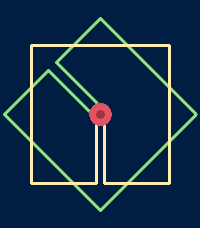</a>

<h2 class="app-name" id="app-54b5d6a97e6bae43f10000d5"><a href="https://apps.repebble.com/54b5d6a97e6bae43f10000d5">Meyer Objects</a> v3.0.0</h2>
<a class="app-source" href="https://github.com/ygalanter/nazar_frames" title="Source code" data-search-exclude>View source</a>

Watchface · <a href="https://forum.rebble.io/t/1159" title="Discuss this app on the Rebble forum" data-search-exclude>Forum thread</a>

Released 2015-01-14 Updated 2026-07-15

Runs on: Round 2, Time 2, Pebble 2 Duo, Pebble 2, Time Round, Time, Classic

Frame Clock. Minimalistic watchface, just two wire frames bearing minute an hour hand. Shake or tap the watch to briefly see digital time, date and status of battery and Bluetooth connection…

<a class="app-shot" href="https://apps.repebble.com/5515a8a75ca749ee33000010" data-search-exclude>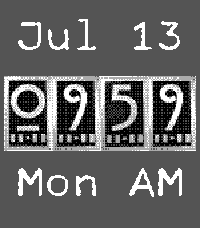</a>

<h2 class="app-name" id="app-5515a8a75ca749ee33000010"><a href="https://apps.repebble.com/5515a8a75ca749ee33000010">Rustic Slider</a> v3.1.0</h2>
<a class="app-source" href="https://github.com/ygalanter/COLOR_SLIDER" title="Source code" data-search-exclude>View source</a>

Watchface · <a href="https://forum.rebble.io/t/1151" title="Discuss this app on the Rebble forum" data-search-exclude>Forum thread</a>

Released 2015-03-27 Updated 2026-07-14

Runs on: Round 2, Time 2, Pebble 2 Duo, Pebble 2, Time Round, Time, Classic

- Date and time in blocky rustic design. - 12/24 hour format support (based on watch setting) - Time tiles appear with sliding effect - User-configurable tile slide direction

<a class="app-shot" href="https://apps.repebble.com/553adb3b375961a6080000c7" data-search-exclude>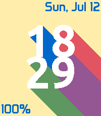</a>

<h2 class="app-name" id="app-553adb3b375961a6080000c7"><a href="https://apps.repebble.com/553adb3b375961a6080000c7">Long Shadow</a> v3.1.0</h2>
<a class="app-source" href="https://github.com/ygalanter/Color_Shadow" title="Source code" data-search-exclude>View source</a>

Watchface · <a href="https://forum.rebble.io/t/1150" title="Discuss this app on the Rebble forum" data-search-exclude>Forum thread</a>

Released 2015-04-25 Updated 2026-07-12

Runs on: Round 2, Time 2, Pebble 2 Duo, Pebble 2, Time Round, Time, Classic

- Featuring large time with long shadows - Date and day of the week - Battery info - User-adjustable shadow direction (Made with EffectLayer https://github.com/ygalanter/EffectLayer)

<a class="app-shot" href="https://apps.repebble.com/6516c39fb2704211b668a318" data-search-exclude>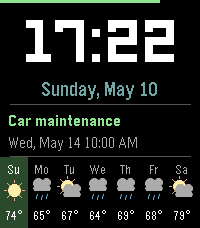</a>

<h2 class="app-name" id="app-6516c39fb2704211b668a318"><a href="https://apps.repebble.com/6516c39fb2704211b668a318">Agenda</a> v1.5.0</h2>
<a class="app-source" href="https://github.com/ygalanter/agenda-pebble" title="Source code" data-search-exclude>View source</a>

Watchface · <a href="https://forum.rebble.io/t/963" title="Discuss this app on the Rebble forum" data-search-exclude>Forum thread</a>

Released 2026-05-10 Updated 2026-07-11

Runs on: Time 2, Pebble 2 Duo, Pebble 2, Time, Classic

Digital watchface that displays time, weather, and your next calendar event. Features - Large digital clock - Date display with day of the week - 7-day weather forecast - Current weather for today…

<a class="app-shot" href="https://apps.repebble.com/16a26261425f4be090bd9e18" data-search-exclude>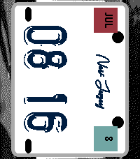</a>

<h2 class="app-name" id="app-16a26261425f4be090bd9e18"><a href="https://apps.repebble.com/16a26261425f4be090bd9e18">License Plate</a> v1.1.0</h2>
<a class="app-source" href="https://github.com/ygalanter/license-plate-pebble" title="Source code" data-search-exclude>View source</a>

Watchface · <a href="https://forum.rebble.io/t/1136" title="Discuss this app on the Rebble forum" data-search-exclude>Forum thread</a>

Released 2026-07-09 Updated 2026-07-09

Runs on: Time 2, Time

License Plate is a digital clock in form of a car license plate. 🎨 Fully customizable colors 📍 Automatically detects and shows your location on the license plate Shaking watch cycles thru: 📍…

<a class="app-shot" href="https://apps.repebble.com/68a9169543ec40999bd1124f" data-search-exclude>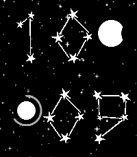</a>

<h2 class="app-name" id="app-68a9169543ec40999bd1124f"><a href="https://apps.repebble.com/68a9169543ec40999bd1124f">Starry Night</a> v1.0.0</h2>
<a class="app-source" href="https://github.com/ygalanter/starry-night-pebble" title="Source code" data-search-exclude>View source</a>

Watchface · <a href="https://forum.rebble.io/t/1133" title="Discuss this app on the Rebble forum" data-search-exclude>Forum thread</a>

Released 2026-07-08 Updated 2026-07-08

Runs on: Time 2, Pebble 2 Duo, Pebble 2, Time, Classic

Digital clock with time composed of star constellations. Phases of the moon in the top right corner represent battery charge Orbit around the planet in the bottom left corner represent fitness…

<a class="app-shot" href="https://apps.repebble.com/9c5f123a606348c3aaa2932a" data-search-exclude>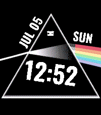</a>

<h2 class="app-name" id="app-9c5f123a606348c3aaa2932a"><a href="https://apps.repebble.com/9c5f123a606348c3aaa2932a">Dark Side</a> v1.1.0</h2>
<a class="app-source" href="https://github.com/ygalanter/dark-side-pebble" title="Source code" data-search-exclude>View source</a>

Watchface · <a href="https://forum.rebble.io/t/1122" title="Discuss this app on the Rebble forum" data-search-exclude>Forum thread</a>

Released 2026-07-05 Updated 2026-07-05

Runs on: Time 2, Time

Digital time in form of familiar prism spectrum. Configurable colors for time, date, day of the week, and activity icon (set to black to hide). Colorful part of rainbow indicates completed fitness…

<h2 class="app-name" id="app-55e76ba4b0f5477de8000064"><a href="https://apps.repebble.com/55e76ba4b0f5477de8000064">Nag for Pebble</a> v1.61.0</h2>
<a class="app-source" href="https://github.com/ygalanter/priv-nag-for-pebble" title="Source code" data-search-exclude>View source</a>

App · <a href="https://forum.rebble.io/t/1096" title="Discuss this app on the Rebble forum" data-search-exclude>Forum thread</a>

Released 2015-09-02 Updated 2026-06-28

Runs on: Round 2, Time 2, Pebble 2 Duo, Pebble 2, Time Round, Time, Classic

Once launched and configured, Nag for Pebble exits immediately so you can keep using your watchface and other apps — but it keeps buzzing your Pebble (every hour by default) in the background. Use…

<h2 class="app-name" id="app-2a901442a4f24729b05837b3"><a href="https://apps.repebble.com/2a901442a4f24729b05837b3">Cannonade</a> v1.3.0</h2>
<a class="app-source" href="https://github.com/ygalanter/cannonade-pebble" title="Source code" data-search-exclude>View source</a>

App · <a href="https://forum.rebble.io/t/946" title="Discuss this app on the Rebble forum" data-search-exclude>Forum thread</a>

Released 2026-05-03 Updated 2026-06-19

Runs on: Time 2

Cannonade is a classic ballistic game between 2 opponents - in this case you and A.I. (or, to be precise - you and your watch). The goal is to destroy opponent&#x27;s fort with your projectile while…

<h2 class="app-name" id="app-52e534556e3045b08c05482e"><a href="https://apps.repebble.com/52e534556e3045b08c05482e">Aquarium</a> v1.2.0</h2>
<a class="app-source" href="https://github.com/ygalanter/Aquarium-Pebble" title="Source code" data-search-exclude>View source</a>

Watchface · <a href="https://forum.rebble.io/t/908" title="Discuss this app on the Rebble forum" data-search-exclude>Forum thread</a>

Released 2026-04-24 Updated 2026-06-19

Runs on: Time 2

Time floating inside of beautiful tropical aquarium. Shake the watch to cycles thru: Date 📅 Day of the week 📆 Steps count 👟 Calories burned 🔥 Distance walked 🚶(miles or kilometers, depending on…

<a class="app-shot" href="https://apps.repebble.com/4989ba26b1ec4de7b757b1d0" data-search-exclude>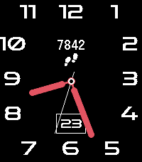</a>

<h2 class="app-name" id="app-4989ba26b1ec4de7b757b1d0"><a href="https://apps.repebble.com/4989ba26b1ec4de7b757b1d0">Pear Hermit</a> v1.0.0</h2>
<a class="app-source" href="https://github.com/ygalanter/pear-hermit-pebble" title="Source code" data-search-exclude>View source</a>

Watchface · <a href="https://forum.rebble.io/t/996" title="Discuss this app on the Rebble forum" data-search-exclude>Forum thread</a>

Released 2026-05-24 Updated 2026-05-24

Runs on: Time 2

Analog clock with familiar look, shows date and activity tracking: Shake the watch to switch betwen - step counter, - distance walked - calories burned, - time active - heart-rate - or battery…

<a class="app-shot" href="https://apps.repebble.com/92633b7db4164e05b58ad66e" data-search-exclude>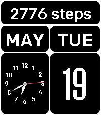</a>

<h2 class="app-name" id="app-92633b7db4164e05b58ad66e"><a href="https://apps.repebble.com/92633b7db4164e05b58ad66e">Strict</a> v1.1.0</h2>
<a class="app-source" href="https://github.com/ygalanter/strict-peble" title="Source code" data-search-exclude>View source</a>

Watchface · <a href="https://forum.rebble.io/t/986" title="Discuss this app on the Rebble forum" data-search-exclude>Forum thread</a>

Released 2026-05-19 Updated 2026-05-21

Runs on: Time 2

Strict is an analog clock with large month, date, and day of the week. Shaking watch cycles thru: - Steps taken 👟 - Calories burned 🔥 - Distance walked 🚶🏻 (miles or kilometers, depending on your…

<h2 class="app-name" id="app-ac29b3f66536476d81206e2a"><a href="https://apps.repebble.com/ac29b3f66536476d81206e2a">Clockwork</a> v1.0.0</h2>
<a class="app-source" href="https://github.com/ygalanter/clockfork-pebble" title="Source code" data-search-exclude>View source</a>

Watchface · <a href="https://forum.rebble.io/t/962" title="Discuss this app on the Rebble forum" data-search-exclude>Forum thread</a>

Released 2026-05-10 Updated 2026-05-10

Runs on: Time 2

A clockpunk-style analog watchface with moving gears, and ticking sound. Original design: https://discourse.fullandroidwatch.org/t/s9wf04-watchface/72874

<h2 class="app-name" id="app-544965ef95176241c9000115"><a href="https://apps.repebble.com/544965ef95176241c9000115">Autoinsult for Pebble</a> v2.0.0</h2>
<a class="app-source" href="https://github.com/ygalanter/Autoinsult-For-Pebble" title="Source code" data-search-exclude>View source</a>

App · <a href="https://forum.rebble.io/t/934" title="Discuss this app on the Rebble forum" data-search-exclude>Forum thread</a>

Released 2014-10-23 Updated 2026-05-02

Runs on: Round 2, Time 2, Pebble 2 Duo, Pebble 2, Time Round, Time, Classic

Whenever you need an unorthodox insult line - this app will be there for you. Select insult style from - Arabian - Shakespearean - Modern - Mediterranean. Based on autoinsult.com

<h2 class="app-name" id="app-2a3821196720411081d3dfc9"><a href="https://apps.repebble.com/2a3821196720411081d3dfc9">Nashki</a> v1.0.0</h2>
<a class="app-source" href="https://github.com/ygalanter/nashki-pebble" title="Source code" data-search-exclude>View source</a>

App · <a href="https://forum.rebble.io/t/932" title="Discuss this app on the Rebble forum" data-search-exclude>Forum thread</a>

Released 2026-05-01 Updated 2026-05-01

Runs on: Time 2

Nashki is a sliding puzzle game tests your visual, logic, and memory skills. Shuffle the pic then try to restore it by tapping on tiles next to empty space to slide them. Game tracks the best…

<a class="app-shot" href="https://apps.repebble.com/4b4d89edc10e48048f0cdb0d" data-search-exclude>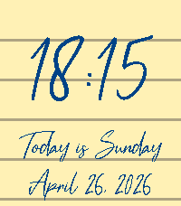</a>

<h2 class="app-name" id="app-4b4d89edc10e48048f0cdb0d"><a href="https://apps.repebble.com/4b4d89edc10e48048f0cdb0d">Cursive</a> v1.0</h2>
<a class="app-source" href="https://github.com/ygalanter/cursive-pebble" title="Source code" data-search-exclude>View source</a>

Watchface · <a href="https://forum.rebble.io/t/916" title="Discuss this app on the Rebble forum" data-search-exclude>Forum thread</a>

Released 2026-04-26 Updated 2026-04-26

Runs on: Time 2

Digital clock as handwritten text ✍️ Customizable colors. 🎨 On shake show stats screen - you can enter up to 5 lines of your own text. Text can contain placeholders that are replaced with stats on…

<a class="app-shot" href="https://apps.repebble.com/d81c8072e4ff47b9bdfca3f8" data-search-exclude>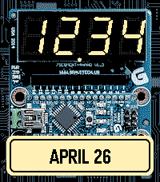</a>

<h2 class="app-name" id="app-d81c8072e4ff47b9bdfca3f8"><a href="https://apps.repebble.com/d81c8072e4ff47b9bdfca3f8">Circuit Clock</a> v1.0</h2>
<a class="app-source" href="https://github.com/ygalanter/arduino-watch-pebble" title="Source code" data-search-exclude>View source</a>

Watchface · <a href="https://forum.rebble.io/t/913" title="Discuss this app on the Rebble forum" data-search-exclude>Forum thread</a>

Released 2026-04-26 Updated 2026-04-26

Runs on: Time 2

Circuit Clock is a digital clock in form of 7-segment open circuit display. - Customizable color of digits 🎨 Shake the watch to cycle thru: Date 📅 Day of the week 📆 AM/PM display Steps count 👟…

<a class="app-shot" href="https://apps.repebble.com/b195ac35bbaa438da49c4d45" data-search-exclude>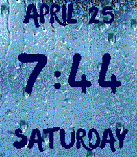</a>

<h2 class="app-name" id="app-b195ac35bbaa438da49c4d45"><a href="https://apps.repebble.com/b195ac35bbaa438da49c4d45">Rainy Day</a> v1.0</h2>
<a class="app-source" href="https://github.com/ygalanter/rainy-day-pebble" title="Source code" data-search-exclude>View source</a>

Watchface · <a href="https://forum.rebble.io/t/910" title="Discuss this app on the Rebble forum" data-search-exclude>Forum thread</a>

Released 2026-04-25 Updated 2026-04-25

Runs on: Time 2

It&#x27;s like looking out of the window on rainy day - relax watching the raindrops while checking time or you fitness stats. Shaking the watch cycles thru Day of the week 📆 Steps count 👟 Calories…

<a class="app-shot" href="https://apps.repebble.com/16d0d2c3f4c941498c5d6a88" data-search-exclude>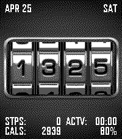</a>

<h2 class="app-name" id="app-16d0d2c3f4c941498c5d6a88"><a href="https://apps.repebble.com/16d0d2c3f4c941498c5d6a88">Combination Lock</a> v1.0</h2>
<a class="app-source" href="https://github.com/ygalanter/Pebble-Combination-Lock" title="Source code" data-search-exclude>View source</a>

Watchface · <a href="https://forum.rebble.io/t/911" title="Discuss this app on the Rebble forum" data-search-exclude>Forum thread</a>

Released 2026-04-25 Updated 2026-04-25

Runs on: Time 2

Combination Lock is a digital watchface that displays time in form of mechanical numerical lock Also shown: Date 📅 Battery charge 🔋 Steps taken 👟 Calories burned 🔥 Active time ⚡ Shake the watch to…

<a class="app-shot" href="https://apps.repebble.com/562a4e4dfd5d7220db00006c" data-search-exclude>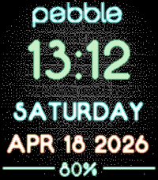</a>

<h2 class="app-name" id="app-562a4e4dfd5d7220db00006c"><a href="https://apps.repebble.com/562a4e4dfd5d7220db00006c">Brick Neon</a> v1.30</h2>
<a class="app-source" href="https://github.com/ygalanter/Brick-Neon" title="Source code" data-search-exclude>View source</a>

Watchface · <a href="https://forum.rebble.io/t/897" title="Discuss this app on the Rebble forum" data-search-exclude>Forum thread</a>

Released 2015-10-23 Updated 2026-04-18

Runs on: Round 2, Time 2, Pebble 2 Duo, Pebble 2, Time Round, Time, Classic

Design and Art Direction by Paul Joel - www.pauljoel.com Simple and straightforward watchface with multi-language support. Featuring time, date, day of the week and battery percentage (on Pebble…

<a class="app-shot" href="https://apps.repebble.com/566642d77da16a2459000087" data-search-exclude>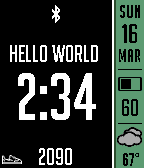</a>

<h2 class="app-name" id="app-566642d77da16a2459000087"><a href="https://apps.repebble.com/566642d77da16a2459000087">Cobblestyle</a> v2.3</h2>
<a class="app-source" href="https://github.com/ygalanter/PebStyle" title="Source code" data-search-exclude>View source</a>

Watchface

Released 2015-12-08 Updated 2025-03-16

Runs on: Round 2, Time 2, Pebble 2 Duo, Pebble 2, Time Round, Time, Classic

Design and Art Direction by Paul Joel - www.pauljoel.com Flexible stylish watchface featuring date, battery info and weather. You can select between analog or digital main clock. Secondary info…

<h2 class="app-name" id="app-55a56b9af4510f3705000050"><a href="https://apps.repebble.com/55a56b9af4510f3705000050">Vortex</a> v2.11</h2>
<a class="app-source" href="http://github.com/ygalanter/vortex" title="Source code" data-search-exclude>View source</a>

Watchface

MIT Released 2015-07-14 Updated 2016-09-14

Runs on: Round 2, Time 2, Pebble 2 Duo, Pebble 2, Time Round, Time, Classic

Minimalistic analog watchface with Vortex animation on every minute. Configurable options include - Bluetooth alert buzz strength - Show Digital time - Show Battery indicator - Show Date - Show…

<h2 class="app-name" id="app-55d633b089b39e1008000024"><a href="https://apps.repebble.com/55d633b089b39e1008000024">Shadow Analog</a> v1.5</h2>
<a class="app-source" href="https://github.com/ygalanter/Shadow_Analog" title="Source code" data-search-exclude>View source</a>

Watchface

Released 2015-08-20 Updated 2016-06-10

Runs on: Round 2, Time 2, Pebble 2 Duo, Pebble 2, Time Round, Time, Classic

- Simple analog watchface with shadow effect.

<a class="app-shot" href="https://apps.repebble.com/552f1bbfc34162f94500007d" data-search-exclude>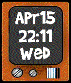</a>

<h2 class="app-name" id="app-552f1bbfc34162f94500007d"><a href="https://apps.repebble.com/552f1bbfc34162f94500007d">TV Time</a> v1.5</h2>
<a class="app-source" href="https://github.com/ygalanter/Tv-Time" title="Source code" data-search-exclude>View source</a>

Watchface

Released 2015-04-16 Updated 2016-06-09

Runs on: Time 2, Pebble 2 Duo, Pebble 2, Time, Classic

- Date, time, day of the week in cartoon TV format - Grid indicates battery level (uses EffectLayer library from https://github.com/ygalanter/EffectLayer)

<a class="app-shot" href="https://apps.repebble.com/55711594e0633d301c00006d" data-search-exclude>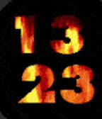</a>

<h2 class="app-name" id="app-55711594e0633d301c00006d"><a href="https://apps.repebble.com/55711594e0633d301c00006d">Fireplace</a> v1.7</h2>
<a class="app-source" href="http://github.com/ygalanter/fireplace" title="Source code" data-search-exclude>View source</a>

Watchface

MIT Released 2015-06-05 Updated 2016-06-09

Runs on: Round 2, Time 2, Pebble 2 Duo, Pebble 2, Time Round, Time, Classic

- Imagine fireplace crackling on your Pebble Time - There&#x27;s a chance that it&#x27;s not battery-friendly.

<h2 class="app-name" id="app-5521f7d1f99b2a0003000095"><a href="https://apps.repebble.com/5521f7d1f99b2a0003000095">Duke</a> v1.5</h2>
<a class="app-source" href="https://github.com/ygalanter/duke" title="Source code" data-search-exclude>View source</a>

Watchface

Released 2015-04-06 Updated 2016-06-09

Runs on: Time 2, Pebble 2 Duo, Pebble 2, Time, Classic

A basic watchface demoing EffectLayer (https://github.com/ygalanter/EffectLayer) It doesn&#x27;t use bitmaps, just a normal text rotated 90°

<a class="app-shot" href="https://apps.repebble.com/54ac997c32203e8f5c000016" data-search-exclude>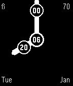</a>

<h2 class="app-name" id="app-54ac997c32203e8f5c000016"><a href="https://apps.repebble.com/54ac997c32203e8f5c000016">Diginalog</a> v2.5</h2>
<a class="app-source" href="https://github.com/ygalanter/diginalog_watchface" title="Source code" data-search-exclude>View source</a>

Watchface

Released 2015-01-07 Updated 2015-10-16

Runs on: Round 2, Time 2, Pebble 2 Duo, Pebble 2, Time Round, Time, Classic

Combination digital and analog watchface. Minute and hour hands bear minute and hour digital values respectfully. Number in the middle is day of the month. Also featuring: Day of the week, month…

<h2 class="app-name" id="app-5477d51f67c622aab70000ee"><a href="https://apps.repebble.com/5477d51f67c622aab70000ee">3D Wedge</a> v2.5</h2>
<a class="app-source" href="https://github.com/ygalanter/3D_Wedge" title="Source code" data-search-exclude>View source</a>

Watchface

Released 2014-11-28 Updated 2015-10-15

Runs on: Round 2, Time 2, Pebble 2 Duo, Pebble 2, Time Round, Time, Classic

- Large time in 3D Wedge effect - AM/PM indicator (for 12h mode) - Date, day of the week - Battery percentage - Bluetooth disconnect notification

<a class="app-shot" href="https://apps.repebble.com/55ce53e8fb84fb752300004f" data-search-exclude>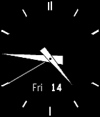</a>

<h2 class="app-name" id="app-55ce53e8fb84fb752300004f"><a href="https://apps.repebble.com/55ce53e8fb84fb752300004f">Ticking Analog</a> v1.0</h2>
<a class="app-source" href="https://github.com/ygalanter/Ticking_Analog" title="Source code" data-search-exclude>View source</a>

Watchface

Released 2015-08-14 Updated 2015-08-14

Runs on: Time 2, Pebble 2 Duo, Pebble 2, Time, Classic

At first glance this looks like classic stock analog face. But bring it to your ear and listen carefully... DISCLAMER 1: 99% code for this watchface is original Katharine Berry&#x27;s &quot;Simple Analog&quot;…

<a class="app-shot" href="https://apps.repebble.com/539dde9c3ce893855d00000e" data-search-exclude>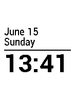</a>

<h2 class="app-name" id="app-539dde9c3ce893855d00000e"><a href="https://apps.repebble.com/539dde9c3ce893855d00000e">Simplicity MOD</a> v1.0.0</h2>
<a class="app-source" href="http://github.com/ygalanter/SimplicityMod" title="Source code" data-search-exclude>View source</a>

Watchface

MIT Released 2014-06-15 Updated 2014-06-15

Runs on: Time 2, Pebble 2 Duo, Pebble 2, Time, Classic

Watchface based on &quot;Simplicity&quot;, but with inverted colors and displaying day of the week.

